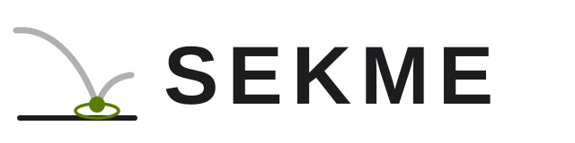
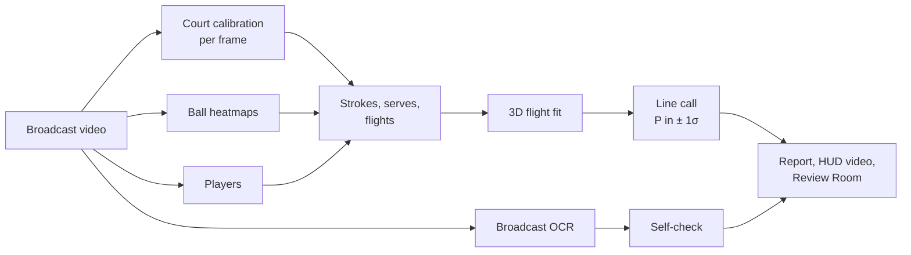

# SEKME — tennis line calls from a single broadcast camera

<picture>
  <source media="(prefers-color-scheme: dark)" srcset="promo/assets/sekme-logo.svg">
  
</picture>

[](https://github.com/omeeragtoprak/sekme/actions/workflows/ci.yml)


*Sekme* is Turkish for the bounce of a ball. From one broadcast video SEKME calibrates the court in
every frame where the painted lines support it, tracks the ball and the players, reconstructs each
shot's flight in 3D with physics and calls the bounces it can measure **with their uncertainty**: P(in),
the distance to the line and a 1σ margin (about four in five shots get a call on the clips below). It is
decisive only at ≥ 95 %; closer calls are shown as the most likely verdict marked *low confidence*.
It then checks itself against what the broadcast shows: the score graphic and the stadium radar board.

> Status: alpha (`3.0.0a1`). Runs end to end on real broadcast footage on an Apple M4 laptop.
> Every number below is measured; the known gaps are listed under *Limitations*.

## Highlights

- **Physics, not pixels.** Bounce-anchored 3D flight fit (gravity, drag, per-phase spin) with a full
  covariance; calls by Monte Carlo against the legal zone; calibration error carried into every call.
- **Own ball network.** A compact U-Net designed and trained in this project on TrackNet. On matches it
  never saw: F1 0.965 at 10 px (WASB, the published reference: 0.955), 0.910 at 4 px (WASB 0.928), at
  56 % of WASB's time per frame. It is the default ([how it was built and tested](docs/MODELS.md)).
- **Found a bias in the labels.** The TrackNet ball labels sit 0.6–1.7 px off the ball's centre,
  differently per match (measured without any network). Our earlier networks learned it and put the
  ball ~2 px low in the image, which on court pulls bounces ~15 cm towards the camera. Ball networks v3
  and v4 are trained on corrected targets: within 0.3 px of the ball's centre, and its bounces moved as predicted ([analysis](docs/EVAL_TRACKNET.md#systematic-offsets-2026-11-13-evidence-in-resultsposition_biastxt)).
- **Independent benchmark.** On human-labelled broadcast bounces from matches never used to fit or
  tune anything (TrackNet games 8–10; used only for accept/reject decisions, each logged): 77 % of first
  bounces after a stroke found, 93 % precision, median 10 cm from the labelled contact, 108 / 108
  decisive calls consistent — few of them close to a line, so this rules out gross errors, it does not
  measure centimetre accuracy ([details](docs/EVAL_TRACKNET.md)).
- **Checks itself.** On-device OCR of the score graphic and the stadium radar board; fitted serve
  speeds are compared with the radar on every serve whose board change is timed to ≤ 4 s.
- **Review Room.** Local web app (FastAPI + React/three.js, Turkish UI): frame-accurate player, mini
  court with 95 % ellipses, 3D replay, analysis, labelling tools for bounces and serves (accuracy and
  serve recall measured on your own footage) and an append-only review log.

## How it works



| Stage | How |
|---|---|
| Court | keypoint heatmaps on keyframes and cuts → homography → sub-pixel refit on the painted line ridges → pinhole camera (focal length and pose) per frame; frames the lines do not back are not measured |
| Ball | three-frame heatmap network, sliding window; track with gating across short misses, removal of detections that stay on one spot of the court (line marks), short-gap fill |
| Players | person detector + ByteTrack, near/far selection on the court plane, speed and size gates; pose at contacts for stroke type |
| Events | strokes = persistent reversals of travel direction; serves = toss above a baseline player after a dead ball, contact where toss and struck flight meet; one bounce per flight by a changepoint on the receiving half |
| 3D flight | contact times free, players' court positions as anchors, serve contact height measured on the camera ray; plausibility gates (speed, height, residual, σ); rejected fits fall back to a gated image-kink bounce |
| Call | Monte Carlo P(in) over the bounce covariance (fit + calibration term) against the zone's outer line edges; play continuing after an OUT downgrades it |
| Self-check | Apple Vision OCR every 0.5 s: names, score, server marker, radar board; within a point the marked server names the serve's end, elsewhere each player's start end (majority of their serves) and ITF Rule 10 end changes do; a board value that flips back within 4 s is dropped; never an input to a call |

More: [docs/ARCHITECTURE.md](docs/ARCHITECTURE.md).

## Models

| Role | Network | Trained by | Data |
|---|---|---|---|
| Ball (default) | **SEKME ball U-Net v4** (`models/ball_unet.py`, ~1.95 M parameters) | this project (`scripts/train_ball.py`) | TrackNet tennis, games 1–7 (a fifth of the clips held out for selection), motion-blur augmentation, targets corrected for the labels' offset; test on 8–10 |
| Ball (reference, `--ball-model`) | WASB HRNet (Tarashima et al., BMVC 2023) | its authors | TrackNet tennis, games 1–7 |
| Court keypoints (default) | **SEKME court U-Net** (`models/court_unet.py`, 5 levels, 14 heatmaps) | this project (`scripts/train_court.py`) | TennisCourtDetector labels: 6 630 training frames (8 841 in all) |
| Court keypoints (reference, `--model court=…`) | TrackNet-style VGG encoder–decoder (yastrebksv/TennisCourtDetector; our re-implementation loads its checkpoint) | its author | same labels |
| Players, pose | Ultralytics YOLO26-s / YOLO26-s-pose | Ultralytics | COCO |

Everything after the networks — calibration refit, tracking, events, the 3D physics fit, the call and
its uncertainty, the self-checks — is this project's code. Person and pose networks of our own were
also distilled from YOLO26 (`scripts/train_players.py`, `scripts/train_pose.py`) and tested on
hand-labelled frames; they fell short of their teacher (players found 63 % vs 85 %, pose PCK 0.71 vs
0.81), so YOLO26 stays the default for those two roles. Details and results: [docs/MODELS.md](docs/MODELS.md).

## Results

The outputs behind these numbers are saved in [results/](results/), each with the script that produced it.

**Simulation** (`sekme benchmark`; camera 28 m back, 11 m high, 1080p, 1.5 px detection noise, spin the
fitter only approximates, half the shots *aimed* within 15–20 cm of a line):

| | 30 fps | 60 fps |
|---|---|---|
| median / p90 bounce error | 4.7 / 10.5 cm | 2.7 / 8.2 cm |
| truth inside the reported 95 % ellipse | 96.7 % | 95.0 % |
| decisive (IN/OUT) calls | 73 % | 93 % |
| wrong decisive calls | 0 / 60 | 0 / 60 |

**TrackNet benchmark** (human-labelled bounces; games 8–10 unseen by the ball network and never used
for tuning):

| games 8–10 | SEKME ball U-Net v4 (default) | SEKME v3 | SEKME v2 | WASB (reference) |
|---|---|---|---|---|
| ball, frame F1 at 4 px / 10 px | 0.910 / 0.965 | 0.921 / 0.969 | 0.922 / 0.965 | 0.928 / 0.955 |
| first bounce after a stroke found | 110 / 142 (77 %) | 109 / 142 (77 %) | 110 / 142 (77 %) | 110 / 142 (77 %) |
| precision | 93 % | 93 % | 94 % | 93 % |
| distance to the labelled contact, median / p90 | 10 / 32 cm | 10 / 30 cm | 16 / 38 cm | 11 / 33 cm |
| the same against the ball's centre (labels corrected per game) | 11 / 33 cm | 11 / 31 cm | 21 / 42 cm | 13 / 37 cm |
| decisive calls consistent with the label | 108 / 108 | 107 / 107 | 107 / 107 | 108 / 108 |
| truth inside the reported 95 % ellipse (1 px label noise) | 91 % | 92 % | 89 % | 91 % |

v4 was chosen over v3 on the held-out clips of games 1–7 by a rule written before training; on games
8–10 (report only) its frame F1 is about a point lower and its bounces are on par with v3's (median
difference +0.2 cm, 95 % interval −0.6 to +1.6 cm by clip bootstrap) and with WASB's (−1.2 cm, −2.5 to
+1.6 cm); v3's are clearly closer than v2's (−6.1 cm, −10.6 to −2.9 cm). See [MODELS.md](docs/MODELS.md).

**Real broadcast** (current defaults; US Open 2023 final highlights, 720p, first 90 s): 2 530 / 2 698
frames calibrated (the rest are close-ups, correctly excluded), line-fit residual 0.34 px, camera
recovered 33 m back and 10 m up; 53 calls on 66 shots (51 IN, 1 OUT checked by eye, 1 low-confidence);
2 / 3 visible serves found (our ball network still misses most of the motion-blurred frames right after
one serve's contact; WASB finds all 3). US Open 2025 final (1080p, 60 fps): 71.5 % of frames
calibrated, 22 calls on 43 shots (ball v3: 26 on 42).

**Radar** ([results/radar.txt](results/radar.txt); 5 official US Open clips, pairs kept only when the board
change is timed to ≤ 4 s). With the current defaults (ball v4): 5 serves, +5.2, +8.1, −2.2, −3.0,
+11.7 % → mean +4.0 % (SE 2.9), mean |error| 6.0 % (ball v3: 6.7 %). The largest error is a fast 60 fps
serve whose contact v4 used to put ten frames early (−16.5 %); with the contact now found inside the
detection gap it is timed correctly and measured 11.7 % fast. Five serves are too few for a bias claim
either way. On development data most of the remaining serve-speed error follows the fit drifting away
from the measured contact height; a candidate that pins it (`--pin-serve-height`, off by default) waits
for its test on unused footage ([EVAL_SERVE_SPEED.md](docs/EVAL_SERVE_SPEED.md)). **Serve contact timing** was tested separately, on 554 s of unused footage against 23 serve
contacts bracketed by eye: every serve the pipeline found has its contact within 2 frames at 60 fps
([EVAL_SERVE_CONTACT.md](docs/EVAL_SERVE_CONTACT.md)).

## Quick start

```bash
uv venv .venv && uv pip install --python .venv/bin/python -e ".[dev]"
# model weights go to models/ (not in the repository, see docs/MODELS.md and docs/LICENSES.md)
sekme analyze data/videos/<clip>.mp4 --out runs/<id>     # report.json, HUD videos
cd web && npm install && npm run build && cd ..
sekme serve --runs runs                                  # Review Room on http://127.0.0.1:8765
sekme benchmark --fps 60                                 # simulated accuracy for a camera setup
pytest                                                   # tests needing weights or videos skip
```

`--reuse-perception` re-runs everything after perception from the cached detections in seconds.
`.venv/bin/python scripts/eval_tracknet.py` reproduces the TrackNet benchmark (dataset under
`data/tracknet/`); `scripts/train_ball.py` and `scripts/eval_ball.py` train and test the ball network.

## Repository layout

```
src/courtvision/   Python package (the internal name; the CLI is `sekme`)
  perception/      court, ball, players, pose        models/   network definitions
  calib/ geometry/ camera, line refit, court model   physics/  3D flight fit
  events/          image_track, hits, serves, flights, strokes
  officiating/     line calls                        broadcast/ OCR of score graphic and radar board
  eval/            labels, TrackNet, E2E-Spot and six-video protocols, run provenance, simulation, broadcast check
  render/ api/     HUD videos, Review Room API       analytics/ sim/ io/
web/               Review Room (React 19, Vite, three.js)
scripts/           training of each network; TrackNet, E2E-Spot, serve-contact and six-video evaluations; label analyses
tests/             unit, regression cases from real footage, API, end to end
docs/              architecture, models, benchmark, licences; history/ holds the original plan
promo/             HyperFrames promo film (footage not included)
```

## Limitations

- One camera at 25–60 fps: centimetre-to-decimetre uncertainty along the camera axis; ITF line-calling
  bands (± 25 mm) are out of reach. Centimetre-level accuracy on real footage is not measured yet: the
  TrackNet reference cannot resolve errors below ~10 cm. The labelling tool in the Review Room
  (*Sekme Noktasını İşaretle*) measures it on your own footage.
- About a quarter of first bounces are still missed on unseen matches, mostly where stroke segmentation
  goes wrong. A learned stroke detector and a near-player rule were tried and rejected because they did
  not hold up on the held-out games; refining the timing of rally hits made the hits more accurate but lost
  first bounces on the development games it was checked on, so it was dropped too
  ([details](docs/EVAL_TRACKNET.md)).
- Serve detection rests on few real serves; serves struck before a camera cut cannot be recovered.
- Lens distortion is not modelled; it is carried as uncertainty (max(court-line RMSE, 0.5 px) per call).
- About 2.7× slower than real time on an M4 for 720p30 (90 s: 246 s without HUD rendering) and about 6× for
  1080p60 (90 s: 556 s), measured 2026-11-14; the ball and person networks take most of it (190 s and 483 s)
  and are GPU-bound, while re-analysing cached detections takes 22 s and 35 s (on a long clip the 3D fits run in
  parallel with `--fit-workers 4`, about 3× faster, same results).
- The SEKME ball network still misses some of the most motion-blurred balls right after a serve
  (one of three serves on the 2023 final clip). It was trained at 30 fps and is fed every second
  frame on 60 fps footage. Trained on 7 matches only: more data is the obvious next step.
- **Serve recall is low at 60 fps.** On 554 s of unused US Open 2025 final footage (1080p60) the pipeline
  finds 6 of the 23 serves shown from the main camera (either ball net); on the same footage at 30 fps
  (every second frame) it finds 18. Some frame-based thresholds were set at 30 fps: the filter for
  court-fixed spots removes the ball hanging at the toss apex at 60 fps, and a near-side serve's struck
  ball is slow per frame, so toss and serve stay one flight ([details](docs/EVAL_SERVE_CONTACT.md),
  [docs/EVAL_SPOT.md](docs/EVAL_SPOT.md)). A candidate that scales those frame counts at 60 fps
  (`--fps-scaled-thresholds`, off by default) finds 20 of the 23 on that clip, now development data; it
  becomes the default only if it passes a rule written for six unused videos
  ([docs/EVAL_SERVE_SPEED.md](docs/EVAL_SERVE_SPEED.md)).
  A change to the dead-ball check
  was tried and rejected earlier ([details](docs/EVAL_TRACKNET.md)). The Review Room's *Servis etiketi*
  section measures serve recall (and, once every serve is marked, precision) on your own footage
  ([labelling guide, Turkish](docs/ETIKETLEME_TR.md)).
- Player selection takes the players' size from one track per half; on a long highlight video mixing
  shots that track can come from a tighter shot, and the near player then goes untracked for long spans
  (2025 final, 150–704 s: 37 % of calibrated frames), so those shots' 3D fits lose their contact anchor. A
  camera-based size gate fixed that but failed its rule elsewhere ([EVAL_PLAYERS.md](docs/EVAL_PLAYERS.md));
  a version with a wider band (`--player-size-from-camera`, off by default) waits for its test on unused
  footage.
- Ball footprint is a fixed 2 cm half-length; point/score inference from play is not implemented (the
  score is read from the broadcast).
- Times are taken from frame numbers, assuming a constant frame rate. A video with irregular frame timestamps
  (a phone dropping frames) gets a warning in its report; phone videos stored sideways with a rotation tag are
  analysed upright.

## License

AGPL-3.0-or-later, see [LICENSE](LICENSE). Model weights and videos are not part of the repository; the
third-party networks keep their own terms ([docs/LICENSES.md](docs/LICENSES.md)). Broadcast footage used
during development is not redistributed.
