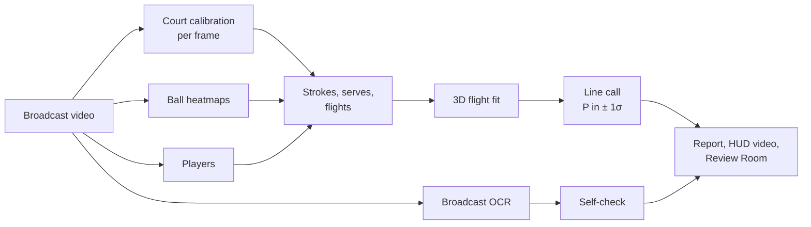

# SEKME — tennis line calls from a single broadcast camera

<picture>
  <source media="(prefers-color-scheme: dark)" srcset="promo/assets/sekme-logo.svg">
  
</picture>

[](https://github.com/omeeragtoprak/sekme/actions/workflows/ci.yml)


*Sekme* is Turkish for the bounce of a ball. From one broadcast video SEKME calibrates the court in
every frame, tracks the ball and the players, reconstructs each shot's flight in 3D with physics and
calls every bounce **with its uncertainty**: P(in), the distance to the line and a 1σ margin. It is
decisive only at ≥ 95 %; closer calls are shown as the most likely verdict marked *low confidence*.
It then checks itself against what the broadcast shows: the score graphic and the stadium radar board.

> Status: alpha (`3.0.0a1`). Runs end to end on real broadcast footage on an Apple M4 laptop.
> Every number below is measured; the known gaps are listed under *Limitations*.

## Highlights

- **Physics, not pixels.** Bounce-anchored 3D flight fit (gravity, drag, per-phase spin) with a full
  covariance; calls by Monte Carlo against the legal zone; calibration error carried into every call.
- **Own ball network.** A compact U-Net designed and trained in this project on TrackNet. On matches it
  never saw: F1 0.958 at 10 px (WASB, the published reference: 0.955), 0.912 at 4 px (WASB 0.928), at
  half WASB's time per frame. It is the default ([how it was built and tested](docs/MODELS.md)).
- **Independent benchmark.** On human-labelled broadcast bounces from matches never used for tuning
  (TrackNet games 8–10): 76 % of first bounces after a stroke found, 92 % precision, median 15 cm from
  the labelled contact, 105 / 105 decisive calls consistent ([details](docs/EVAL_TRACKNET.md)).
- **Checks itself.** On-device OCR of the stadium radar board: fitted serve speeds vs radar on 6 timed
  serves from 5 official US Open clips: mean −0.5 %, mean |error| 4.9 %.
- **Review Room.** Local web app (FastAPI + React/three.js, Turkish UI): frame-accurate player, mini
  court with 95 % ellipses, 3D replay, analysis, labelling tool and an append-only review log.

## How it works



| Stage | How |
|---|---|
| Court | keypoint heatmaps on keyframes and cuts → homography → sub-pixel refit on the painted line ridges → pinhole camera (focal length and pose) per frame; frames the lines do not back are not measured |
| Ball | three-frame heatmap network, sliding window; track with gating across short misses, removal of detections that stay on one spot of the court (line marks), short-gap fill |
| Players | person detector + ByteTrack, near/far selection on the court plane, speed and size gates; pose at contacts for stroke type |
| Events | strokes = persistent reversals of travel direction; serves = toss above a baseline player after a dead ball, contact where toss and struck flight meet; one bounce per flight by a changepoint on the receiving half |
| 3D flight | contact times free, players' court positions as anchors, serve contact height measured on the camera ray; plausibility gates (speed, height, residual, σ); rejected fits fall back to a gated image-kink bounce |
| Call | Monte Carlo P(in) over the bounce covariance (fit + calibration term) against the zone's outer line edges; play continuing after an OUT downgrades it |
| Self-check | Apple Vision OCR every 0.5 s: names, score, server marker, radar board; ITF Rule 10 end changes name the near/far player; never an input to a call |

More: [docs/ARCHITECTURE.md](docs/ARCHITECTURE.md).

## Models

| Role | Network | Trained by | Data |
|---|---|---|---|
| Ball (default) | **SEKME ball U-Net** (`models/ball_unet.py`, ~1.95 M parameters) | this project (`scripts/train_ball.py`) | TrackNet tennis, games 1–5; selection on 6–7; test on 8–10 |
| Ball (reference, `--ball-model`) | WASB HRNet (Tarashima et al., BMVC 2023) | its authors | TrackNet tennis, games 1–7 |
| Court keypoints (default) | **SEKME court U-Net** (`models/court_unet.py`, 5 levels, 14 heatmaps) | this project (`scripts/train_court.py`) | TennisCourtDetector labels, 8 841 broadcast frames |
| Court keypoints (reference, `--model court=…`) | TrackNet-style VGG encoder–decoder (yastrebksv/TennisCourtDetector; our re-implementation loads its checkpoint) | its author | same labels |
| Players, pose | Ultralytics YOLO26-s / YOLO26-s-pose | Ultralytics | COCO |

Everything after the networks — calibration refit, tracking, events, the 3D physics fit, the call and
its uncertainty, the self-checks — is this project's code. Person and pose networks of our own are being
distilled from YOLO26 (`scripts/train_players.py`, `scripts/train_pose.py`); until they pass the same
kind of test, YOLO26 stays the default for those two roles. Details and results: [docs/MODELS.md](docs/MODELS.md).

## Results

**Simulation** (`sekme benchmark`; camera 28 m back, 11 m high, 1080p, 1.5 px detection noise, spin the
fitter only approximates, half the shots within 15–20 cm of a line):

| | 30 fps | 60 fps |
|---|---|---|
| median / p90 bounce error | 4.7 / 10.5 cm | 2.7 / 8.2 cm |
| truth inside the reported 95 % ellipse | 96.7 % | 95.0 % |
| decisive (IN/OUT) calls | 73 % | 93 % |
| wrong decisive calls | 0 / 60 | 0 / 60 |

**TrackNet benchmark** (human-labelled bounces; games 8–10 unseen by the ball network and never used
for tuning):

| games 8–10 | SEKME ball U-Net (default) | WASB (reference) |
|---|---|---|
| ball, frame F1 at 4 px / 10 px | 0.912 / 0.958 | 0.928 / 0.955 |
| first bounce after a stroke found | 108 / 142 (76 %) | 110 / 142 (77 %) |
| precision | 92 % | 93 % |
| distance to the labelled contact, median / p90 | 15 / 38 cm | 11 / 33 cm |
| decisive calls consistent with the label | 105 / 105 | 108 / 108 |

**Real broadcast** (US Open 2023 final highlights, 720p, first 90 s): 2 530 / 2 698 frames calibrated
(the rest are close-ups, correctly excluded), line-fit residual 0.34 px, camera recovered 33 m back and
10 m up; 52 calls on 66 shots (50 IN, 1 OUT checked by eye, 1 low-confidence); 2 / 3 visible serves found
(our ball network misses the motion-blurred first frames after one serve's contact; WASB finds all 3).
On the 60 fps 2025 final the same pipeline makes 24 calls (WASB: 26) and agrees with WASB on every
bounce both call.

**Radar** (5 official US Open clips, pairs kept only when the board change is timed to ≤ 4 s): 6 serves,
mean −0.5 % (SE 2.5 %), mean |error| 4.9 %, SD 6.1 %.

## Quick start

```bash
uv venv .venv && uv pip install --python .venv/bin/python -e ".[dev]"
# model weights go to models/ (not in the repository, see docs/MODELS.md and docs/LICENSES.md)
sekme analyze data/videos/<clip>.mp4 --out runs/<id>     # report.json, HUD videos
cd web && npm install && npm run build && cd ..
sekme serve --runs runs                                  # Review Room on http://127.0.0.1:8765
sekme benchmark --fps 60                                 # simulated accuracy for a camera setup
pytest                                                   # tests needing weights or videos skip
```

`--reuse-perception` re-runs everything after perception from the cached detections in seconds.
`.venv/bin/python scripts/eval_tracknet.py` reproduces the TrackNet benchmark (dataset under
`data/tracknet/`); `scripts/train_ball.py` and `scripts/eval_ball.py` train and test the ball network.

## Repository layout

```
src/courtvision/   Python package (the internal name; the CLI is `sekme`)
  perception/      court, ball, players, pose        models/   network definitions
  calib/ geometry/ camera, line refit, court model   physics/  3D flight fit
  events/          image_track, hits, serves, flights, strokes
  officiating/     line calls                        broadcast/ OCR of score graphic and radar board
  eval/            labels, TrackNet, simulation, broadcast check
  render/ api/     HUD videos, Review Room API       analytics/ sim/ io/
web/               Review Room (React 19, Vite, three.js)
scripts/           TrackNet benchmark, ball-network training and test
tests/             unit, regression cases from real footage, API, end to end
docs/              architecture, models, benchmark, licences; history/ holds the original plan
promo/             HyperFrames promo film (footage not included)
```

## Limitations

- One camera at 25–60 fps: centimetre-to-decimetre uncertainty along the camera axis; ITF line-calling
  bands (± 25 mm) are out of reach. Centimetre-level accuracy on real footage is not measured yet: the
  TrackNet reference cannot resolve errors below ~10 cm. The labelling tool in the Review Room
  (*Sekme Noktasını İşaretle*) measures it on your own footage.
- About a quarter of first bounces are still missed on unseen matches, mostly where stroke segmentation
  goes wrong. A learned stroke detector and a near-player rule were tried and rejected because they did
  not hold up on the held-out games.
- Serve detection rests on few real serves; serves struck before a camera cut cannot be recovered.
- Lens distortion is not modelled; it is carried as uncertainty (max(court-line RMSE, 0.5 px) per call).
- About 3× slower than real time on an M4 (90 s of 720p: 268 s without HUD rendering; was 438 s).
- The SEKME ball network is weaker than WASB on the most motion-blurred balls (right after a serve)
  and on 60 fps footage it was not trained on; it is fed every second frame there to match its
  30 fps training. Trained on 5 matches only — more data is the obvious next step.
- Ball footprint is a fixed 2 cm half-length; point/score inference from play is not implemented (the
  score is read from the broadcast).

## License

AGPL-3.0-or-later, see [LICENSE](LICENSE). Model weights and videos are not part of the repository; the
third-party networks keep their own terms ([docs/LICENSES.md](docs/LICENSES.md)). Broadcast footage used
during development is not redistributed.
