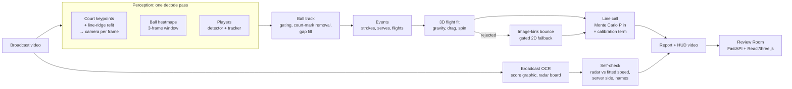

# Architecture

SEKME turns one broadcast video into line calls with an uncertainty, a review log and checks against
what the broadcast itself shows. Everything runs locally (Apple Silicon or CPU).

## Stages and modules

| Stage | Module | What it produces |
|---|---|---|
| Video I/O | `io/video.py` | frames, metadata, writer for HUD videos |
| Court calibration | `perception/court.py`, `models/court_unet.py` (our network, default) or `models/court_net.py`, `calib/line_refine.py`, `calib/camera.py`, `geometry/court.py` | per-frame homography and pinhole camera; frames not backed by the painted lines are marked uncalibrated |
| Shot cuts | `perception/court.py` (`detect_shot_cuts`) | segment boundaries; no flight crosses a cut |
| Ball | `perception/ball.py`, `models/ball_unet.py` (our network, default) or `models/wasb_hrnet.py` | per-frame candidates → one cleaned track (outliers, court marks, short gaps); 60 fps video feeds every second frame |
| Players and pose | `perception/players.py`, `perception/pose.py`, `models/person_unet.py`, `models/pose_unet.py` (our distilled networks) or YOLO26 | near/far player tracks on the court plane (tracks reset at cuts); keypoints at contacts |
| Image-track geometry | `events/image_track.py` | two-piece changepoints, line-meeting kinks (bounces, serve contact) |
| Strokes | `events/hits.py` | persistent reversals of the ball's travel direction |
| Serves | `events/serves.py` | toss above a baseline player after a dead ball, contact at the toss/struck-flight meeting point |
| Flights | `events/flights.py`, `physics/flight.py` | one bounce per flight, 3D fit, plausibility gates, gated 2D fallback |
| Calls | `officiating/line_call.py` | P(in), margin and 1σ across the governing line; IN/OUT only at ≥ 95 % |
| Strokes type | `events/strokes.py` | forehand / backhand / volley / overhead / serve, hand |
| Broadcast check | `broadcast/ocr.py`, `broadcast/scoreboard.py`, `eval/broadcast_check.py` | names, score, serve-speed board; used to check the system, never as an input to a call |
| Analytics | `analytics/kinematics.py` | player speed, distance, peaks |
| Output | `pipeline.py`, `render/hud.py`, `api/app.py`, `web/` | `report.json`, `frames.json`, HUD videos, Review Room with an append-only review log |
| Training and evaluation | `models/unet.py`, `scripts/train_*.py`, `scripts/eval_*.py`, `eval/labels.py`, `eval/tracknet.py`, `eval/spot.py`, `eval/six_videos.py`, `eval/provenance.py`, `eval/sim_benchmark.py` | our networks' training, own-footage labels, TrackNet benchmark, E2E-Spot and six-video test protocols with their run checks, simulation benchmark, network tests |

## Design rules

- **Never more certain than the evidence.** Every bounce carries a covariance from the fit plus a
  calibration term; a call is decisive only at ≥ 95 %. Close calls are shown as the most likely
  verdict marked *low confidence*.
- **Measure, do not assume.** Each change to the event logic is checked on independent data
  (TrackNet games never used for tuning, the stadium radar) and rejected when it does not hold up there;
  rejected experiments are documented in `docs/EVAL_TRACKNET.md`.
- **Caches are keyed by the video hash, the networks and the settings they depend on** (ball stride,
  calibrator keyframe interval, shot-cut threshold, person input size; poses also by each hit's side and box).
  `--reuse-perception` re-runs everything after perception without the networks (seconds on a short clip, a few
minutes on a long one), which is how regressions are checked.

## Candidates (off by default)

Changes that are written and tested but not yet decided run only with their flag; each has a rule written
before its test data is seen, and becomes the default only by that rule (rejected ones are removed and
documented). `report.json` lists the flags a run used under `candidates`.

| Flag | What it changes | Decided by |
|---|---|---|
| `--fps-scaled-thresholds` | frame counts set on 30 fps video (court-fixed filter, toss-run gap, toss speed per frame) scaled by round(fps / 30) | `docs/EVAL_SERVE_SPEED.md`, second candidate |
| `--player-size-from-camera` | the player size gate from the calibrated camera (band 0.5–1.6 of a standing 1.85 m player) instead of one track's median height | `docs/EVAL_SERVE_SPEED.md`, third candidate |
| `--pin-serve-height` | the flight fit held at the serve contact height measured on the camera ray (±0.05 m) | `docs/EVAL_SERVE_SPEED.md` |
| `--toss-bridge` | a toss run may span a missed apex; the serve contact is searched over the whole run | withdrawn from its test (`docs/EVAL_SPOT.md`); reported only |

## Where the time goes (profiled 2026-11-14)

A run from cached detections (`--reuse-perception --no-render`) of the 554 s, 60 fps US Open 2025 final clip
takes 185 s: 164 s analysis, of which the 3D flight fits are about 89 % (`physics/flight.py`: 164 fits,
~38 000 batched RK4 integrations, ~12 million acceleration evaluations on batches of about 12 rows). The cost
is NumPy's per-call overhead on such small arrays, not arithmetic. Fewer RK4 steps would not help at 60 fps
(already one step per frame there; only 30 fps clips take two) and would change results; larger gains need
compiled code, which means a new dependency. Nothing was changed; this is the reference for the six-video
test's cached variant runs (five per video).

**Memory (measured 2026-11-14, 554 s clip, 33 209 frames, cached detections).** Peak 711 MB in the process:
347 MB after importing the libraries, then the detections (+300 MB, mostly the person boxes), calibration
(+25 MB) and the rest of the analysis (+40 MB); the frame file is 4.9 MB of text. About 11 kB per frame, so a
two-hour match at 60 fps (~430 000 frames) would need about 5 GB and a 64 MB frame file: within this machine's
16 GB, but not tested on such a video.

**Perception on 1080p60 (measured 2026-11-14, first 600 frames of the 2025 final clip, MPS).** 67 ms per frame:
the ball network 31.7 ms (one inference per frame on a t, t+2, t+4 window), the person network (YOLO26-s at
1280 px, tracked) 34.5 ms, decoding 0.7 ms, cut detection 0.1 ms; the court calibrator's worker thread never held
the loop up. Both networks are bound by GPU arithmetic: batching 2-8 ball windows per call gives bit-identical
heatmaps but only about 5 % less time per window, and PyTorch's MPS backend runs one stream, so running the two
networks in separate threads would not overlap their GPU work. Faster perception would mean fewer inferences
(e.g. every second window at 60 fps) or smaller inputs, which change the detections and would need their own
rule and test; nothing was changed. (These 600 frames cost less per frame than the README's full-run figures for
a 90 s 1080p60 clip, 190 s and 483 s; the cost depends on the scene and on the machine's load.)

**The fits in worker processes (2026-11-14).** The flights of a run are planned in order and then fitted
independently of each other, so `build_flights` can hand the fits to a process pool (`--fit-workers N` or
`SEKME_FIT_WORKERS`; workers get the track, calibration and players once). On the same clip, cached detections,
no rendering or OCR: analysis 143.2 s in turn (the 164 s above was measured earlier, under other load), 45.4 s
with 4 workers, and the report is identical apart from its
creation time and timings (also checked in a test, flight by flight, to the bit). The library fits in turn by
default: the workers import the code afresh, so a script that patches it at run time (as the development
experiments in `devir/scratch` do, calling `pipeline.analyze` in-process) must stay at one process. `sekme analyze`
and `sekme serve` are never patched, so they default to half the cores, at most 4 (`--fit-workers 1` or
`SEKME_FIT_WORKERS=1` fits in turn); the evaluation scripts run the command line in a subprocess and get the same
results faster. Short runs (fewer than 24 fits) are fitted in turn anyway.

**Review Room on a long run (measured 2026-11-14, 554 s clip, 33 209 frames, 237 shots).** Playback and frame
steps: the timeline used to rebuild its ~600 markers on every frame (54.7 ms median per step, development
build); it now builds them once per run, selection and zoom (3.9 ms). Opening the run takes about 2 s (warm):
the 4.8 MB frame file parses in 11 ms; the panels' React rendering is ~2.2 s in the development build (a few
times less in production); a layout pass over ~4 500 elements (~0.4 s) and a forced reflow (~0.4 s) account for
much of the rest. (Both were taken up later the same day, below: the forced reflow came from the frame overlay,
and off-screen shot rows are no longer rendered.)

**Switching runs, attributed (2026-11-14, production and profiling builds, same clip).** On this machine under
other load, identical switches to the 554 s run took 1–6 s until the shot list was painted, so wall-clock times
are not comparable between builds; the work was attributed with the browser's CPU profile instead. While the
next report loads, the page shows a spinner, so every panel is unmounted and mounted again. The largest single
part was the 3D replay: each mount created a new WebGL context, compiled its shaders, rebuilt the court and
uploaded its texture (about 0.9 s for context and court, then about 1.4 s of first renders with the texture
upload in one profile; GPU-bound calls stall longer while the new video starts decoding). **Changed:** the
renderer, scene and camera are made once per page and the panel only attaches and detaches the canvas
(`Replay3D.tsx`, `getEngine`); a lost WebGL context is detected on the next mount and replaced, a context
restored while mounted gets the theme colour again, and the pixel ratio is read on every mount. Its render loop
now runs only while something changes (camera easing after a drag, a preset move, playback, a redraw request):
idle, the page requests no animation frames (it used to request one every frame for the life of the page).
Checked: WebGL
contexts created over a page load and three run switches 3 → 1; after the switch no context creation, shader
compilation, court build or texture upload appears in the profile; replay, presets and playback work after a
switch and after a forced context loss. The forced reflow on opening came from the frame overlay reading its
canvas's on-screen height while drawing; that height now comes from the canvas's ResizeObserver
(`VideoStage.tsx`), and the profile of a switch shows no layout forced by script (before: about 30 ms in one
profile, more under load). The rest of a switch is React unmounting and mounting about 4 500
elements, the frame overlay and layout. Counted on the 554 s run: of the page's 3 202 elements the shot list
holds 2 233 (237 rows of 10) and the timeline 749; everything else is about 220. Keeping the panels mounted
while the next run loads would therefore save little, and was not done. Instead the shot rows use
`content-visibility: auto` (rows outside the list's view are not styled, laid out or painted; they stay in the
accessibility tree): in the browser's trace of the same switch, the largest layout went from 4 467 to 1 195
objects, all layouts from 4 680 to 1 936 and styled elements from 3 205 to 1 551 (counts, which do not depend on
the machine's load as times do); Lighthouse stays at 100, and keyboard selection to the last row and back
scrolls and draws the row (checked with End, ArrowUp and Home).

**Review ↔ analysis page.** The analysis page used to be built from scratch on every switch (all its charts and
tables over the run's shots, then a layout of the new page) and torn down on the way back. It is now built the
first time it is opened for a run and then only hidden by a wrapper (`App.tsx`, `analysis-host`), so later
switches change two `hidden` attributes and re-render nothing of it (checked: after the first open a switch
adds or removes at most three nodes); player names are formatted once (`displayName` caches them; the page
asked for the same few names thousands of times on the 554 s run), and the video overlay is not redrawn while
the review page is hidden.

## Frame rates

The networks and most thresholds were developed on 30 fps video (TrackNet). The ball network adapts by
its input stride (frames 0, 2, 4 at 60 fps). Thresholds in seconds (`0.12 * fps`, `0.4 * fps`, the dead-ball
second) mean the same at any rate; those counted in frames cover half the time at 60 fps:

| Count (frames) | Where | At 30 fps | At 60 fps | `--fps-scaled-thresholds` |
|---|---|---|---|---|
| court-fixed window ±15, 10 hits | `perception/ball.py` `drop_court_fixed` | ±0.5 s, 0.33 s | ±0.25 s, 0.17 s: removes the toss apex | scaled |
| toss-run gap 2, toss speed per frame | `events/serves.py` | 0.07 s | 0.03 s | scaled |
| tracker gap 6 | `perception/ball.py` `track_ball` | 0.2 s | 0.1 s | not scaled |
| serve contact windows (b − 2 … b + 3, `refine_contact` 3, `contact_in_gap` 2) | `events/serves.py`, `events/image_track.py` | 0.07–0.1 s | 0.03–0.05 s | not scaled |
| skipped contact frames (s + 2, e − 1) | `events/flights.py` | 0.07 s | 0.03 s | not scaled |
| image-kink points (2 each side) | `events/flights.py` `image_bounce` | 0.07 s | 0.03 s | not scaled |

The 60 fps development evidence (US Open 2025 clips and the same footage at 30 fps) is in
`docs/EVAL_SERVE_SPEED.md`; the rows marked "not scaled" are candidates for a later round.

## Known issues (code review, 2026-11-14)

Two code reviews read the event, physics, call, tracker, calibration and OCR modules. The bugs that could
change a ball track or crash were fixed (`docs/EVAL_TRACKNET.md`, "Ball tracker bugs"; the OCR and
calibration guards). These two were left at first, because changing them changes how existing broadcast
graphics are read and that can only be checked by re-reading every clip (the first was then corrected, the
second remains open; see the result below):

- `broadcast/scoreboard.py`: the tolerance for lining up score columns is half a row height in normalised
  x, which is about 0.9 row heights in pixels on 16:9 video; a missing digit in one row could take the
  other row's token.
- `broadcast/scoreboard.py`: a graphic without a point column whose last set reads "0 0" is taken as
  showing points, so that frame's end-change count is one short (it can only mislabel names, never a call).

**Rule for fixing these two (written 2026-11-14, before any comparison).** Fixes: the column tolerance converted
to horizontal units with the frame's aspect ratio (half a row height in pixels); a last column whose values are
all "0" and that holds no point-only value (15, 30, 40, AD) is a games column, not points, unless the graphic's
other readings in the same clip show a point column. Measured on the six broadcast clips with the OCR run once
more and its text boxes kept (so later parsing changes need no OCR): every score reading the fixes change is
checked by eye on its frame. Adopted if the fixed reading is right on more of the changed frames than the old
one and the serve-anchored names of the US Open 2025 final 150–704 s clip stay 21 / 21 correct against the
labeller's serve identities; if no reading changes, adopted as a correctness fix with that result recorded.
Otherwise the code stays and the result is recorded here.

**Result (2026-11-14).** The six clips were read again by OCR (2402 frames, one every 0.5 s) and each frame was
parsed by the old and the corrected column tolerance: **no reading changed** (real graphics space their columns
about 0.023 of the frame width apart, wider than either tolerance), so the tolerance correction is adopted as a
correctness fix and the 2025 final's names are unchanged by construction. The "0 0" case **never occurred** (no
reading with a 0–0 point column in any frame), so the second correction, which needs the clip's other readings
to decide, was not written: nothing here could test it, and it stays a known issue. The text boxes are kept in
`data/broadcast_ocr/` (per frame, with the frame size; re-parsing without the video skips the serving marker),
collected by `devir/scratch/ocr_collect.py`.

Also from the pipeline review (2026-11-14), checked and left:

- The serving hand is voted per player name; without names (no OCR), per side, which pools two players
  across an end change and can mislabel a left-hander's forehand and backhand (strokes only, never a call).
- `perception/ball.py`: the tracker keeps predicting across at most 5 missed frames (`i - last <= max_gap`, the
  frame of the miss's end counted), while gap filling fills up to 6. Found by a test review (2026-11-15) and
  pinned by a test (`tests/test_ball_tracking_edges.py`); making the two agree changes the tracker, so it needs
  its own rule and was left. Counted afterwards (2026-11-16, `devir/scratch/gap6_count.py`): after 6 missed
  frames the next detection is picked without the gate and the 6 frames are then filled as if linked. The six
  v4 broadcast runs (66 645 frames) have 63 filled gaps of exactly 6 frames, more than of 5 (55) or 4 (62), and
  21 of them lie inside a flight that makes a call; TrackNet games 1–7 have one, inside no called flight. The
  fit and the bounce use detected frames only, so such a gap can reach a call only through the hit detector,
  which reads the filled track (`events/hits.py`, the image-y direction). A change would be judged on stroke
  timing, which needs held-out events (the E2E-Spot test matches or the six US Open videos, both waiting for a
  download yes); until then it stays.
- `events/hits.py`: a direction reversal within about 5 frames of a measurable segment's edge is not detected (the
  direction window is cut off there), and one exactly on a boundary is found by neither side; so a stroke right
  next to a camera cut or a calibration gap is missed. Found by a test review (2026-11-15) and pinned
  (`tests/test_events_edges.py`); changing it changes the event detection and needs its own rule. Counted
  afterwards on TrackNet games 1–7 (development; 2026-11-16, `devir/scratch/edge_strokes.py`): 4 of the 367
  labelled strokes inside a measurable segment lie within 5 frames of its edge, and 2 of those 4 have no hit
  within 3 frames (against 95 of the 363 further in). With at most two strokes to gain there, no rule was written.
- `events/flights.py`: a leading flight (no hit before it) whose track runs on through a second shot takes its
  hitter from the first and last image rows, so it can come out on the wrong side and its fit is then rejected
  (no call, not a wrong one). Noted by a test review (2026-11-15), not changed. Counted afterwards on the six v4
  broadcast runs (2026-11-16, `devir/scratch/leading_ender.py`, from their reports): 44 leading flights; 37 end in
  a seen stroke and in 36 of them the inferred hitter is already that stroke's opponent, so taking the hitter
  from the ender instead would change one flight, which is rejected (8 consistent observations) and makes no
  call either way. The other 7 have no seen next stroke, where only the direction can decide; one of them makes a
  call (US Open 2025 quarter-final, frames 3492–3528, IN), and its fit passed the plausibility gates. With at most
  one flight to gain, no rule was written.
- Poses are read by seeking to each hit frame; on the 60 fps 1080p footage 25 of 25 sampled frames were
  identical to sequential decoding, so this was not changed.
- `analytics/kinematics.py` (player speed and distance, never a call): the outlier filter looks at 9 frames, so
  a box that jumps onto someone else for 5 frames in a row is the majority there and is kept; on a synthetic
  walk at 18 km/h this reports a 61.6 km/h peak and 26.5 m for 14.8 m walked. A run of valid frames shorter
  than the 0.6 s smoothing window gets no speed, but its raw, unsmoothed steps still count towards the distance.
  Found by a test review (2026-11-16) and pinned (`tests/test_analytics_eval_edges.py`); left, since a change
  would need labelled player tracks to judge it. On the six v4 broadcast runs (12 player tracks, read from their
  reports) neither shows much: the peaks are 14.0–22.3 km/h, no step between frames exceeds 1 m, camera cuts add
  at most 0.1 m, and the unsmoothed short runs give 44.6 m of the 2 627.8 m in all (1.7 %).
- `broadcast/scoreboard.py`: a player name with a dotted initial ("ALCARAZ G.", "J.-W. TSONGA") is not read
  as a name, and the fuzzy match for the speed board's label also accepts look-alike words ("SERVICE",
  "SPEEDY"). Neither occurs in the six broadcast clips: their names are read as surnames or full names (no
  dotted initial), and of their 50 942 kept OCR text boxes none contains either word, every box taken as the
  label being the serve-speed caption or its misreadings ("SERVE SPEEO", "SCRVE SPEED"). Found by a test
  review (2026-11-16), pinned (`tests/test_pipeline_scoreboard_physics_edges.py`) and left, since a change
  alters how graphics are read and needs the re-read of every clip described above.
- Review Room API (fixed 2026-11-16, found by a test review): a link in place of one of a run's own files
  (`report.json`, `frames.json`, the three `.jsonl` logs, `classic.mp4`, `pro.mp4`) was followed, so with write
  access to the runs folder the API could be made to read or append outside it; such a run is now refused and
  not listed (only `source.*` may point elsewhere, to the original video). The logs' reader now ends records only
  at "\n", skips a byte order mark, a line with invalid UTF-8 and anything that is not a record, instead of
  losing the first record or failing the whole log; and an append after a line torn by a crash first ends that
  line, where the new record used to be glued to the fragment and lost with it. A security review the same day
  added: no page may frame the Review Room (`X-Frame-Options`, `frame-ancestors 'none'`; a framed page could be
  clicked into reviews) and nothing is sniffed (`nosniff`); a write the browser marks `Sec-Fetch-Site:
  cross-site` is refused like one with a foreign Origin; a body declared larger than its limit (an upload over
  2 GiB plus 1 MiB of form, any other write over 1 MiB) is refused before the framework buffers it to disk; an
  upload that fails mid-write leaves no partial file; and a failed analysis reports its error with the run and
  upload names instead of server paths. Left, as accepted for a local tool: a body sent without a declared
  length is still buffered before the limit applies, parallel uploads each pass the free-space check, and a
  link swapped in between the check and the open needs local write access.
- `calib/line_refine.py`: a ridge cut by the end of its search window is still returned (biased towards the
  window, e.g. −8.75 px for a ridge centred at −9) instead of being refused; and the colour histogram behind the
  shot-cut test (`perception/court.py`) is sharp enough that a flat, untextured frame made 15 grey levels
  brighter counts as a cut (broadcast frames, with texture and noise, do not). Both found by a test review
  (2026-11-16) and pinned (`tests/test_io_lines_cuts_edges.py`); a change to either alters calibration or cuts
  and would need its own rule.
- `eval/broadcast_check.py`: end changes are counted from the games columns, with a tiebreak as one game, while
  the players also change ends after every 6 tiebreak points; during a tiebreak (and after one, depending on its
  points) the graphic's names can be on the wrong ends (names only, never a call). Pinned
  (`tests/test_broadcast_check_hud_edges.py`) and left: the graphic shows tiebreak points only while it lasts.
  Of the six v4 broadcast runs only the US Open 2023 final 90–179 s clip has one (second set; the graphic's last
  reading during it shows 5–4 in points, and the match record gives 7–5): none of its flights during the tiebreak
  was named, and 12 points are two extra changes, so the names after it are unaffected.

Fixed in the same review: the perception cache key now includes the calibrator's keyframe interval, the
shot-cut threshold and the person detector's input size (older caches are read as made with the defaults,
which have not changed since they were added); the pose cache key includes each hit's side and player box, so
another player selection at the same frames (`--player-size-from-camera`) does not reuse the poses; a labelled
bounce on the other half of the court is scored as outside its zone, not inside it (zones are open at the net).

## Radar board pairing: wide update windows without a cut (rule written 2026-11-14, before measuring)

A board value is tied to a serve only when the change is seen within 4 s (`MAX_UPDATE_WINDOW_S`), so that a
value following an edited-out serve is not given to the next one. On the US Open 2025 final 150–704 s clip, whose
19 matched serves have the board read by eye, only a minority get an automatic value (measured below: 1 on the
default run, 9 on the scaled 60 fps run); most of the rest are dropped for that window although the board shows the right number (the board is not on screen
all the time). **Change:** a wider window is accepted when the serve's whole search window lies inside one span
the pipeline could analyse (no shot cut, calibrated) and exactly one serve is a candidate, since then no
edited-out serve can be behind the value. **Rule:** adopted if, on that clip (development data; the scaled
60 fps run, which finds 20 of its 23 serves, and the default run), the automatic values that agree with the eye
reading (within 1 mph) rise by at least 3 in total and no automatic value disagrees that agreed before; the
five radar clips' table (`results/radar.txt`) is reported, not used. Otherwise the code stays and the result
is recorded here.

**Result (2026-11-14): not adopted.** Automatic values on the eye-read serves: default run 1 agreeing before
and after; scaled run 8 agreeing and 1 disagreeing before and after (+0, the rule asked for +3); the pairs
with a window of at most 4 s were identical to the earlier report. In highlight footage a widened window plus the
6.5 s serve lag spans more than 10 s, which almost never lies inside one cut-free span, so the dropped updates
stay dropped. The code was left as it was. The one disagreeing value (serve at frame 186: board read 101 mph by
eye, paired 125) is the stale-value case noted above.

## Player identity from clothing (rule written 2026-11-15, before the test match was looked at)

**Finding.** Player names on shots come from the broadcast graphic: from a serve whose server the graphic marks
(reliable, but few serves are seen in highlights), else from each player's start end and the number of end
changes counted from the games on the nearest graphic. OCR often misreads those games in highlight footage:
digits merge (2024 final: Fritz "34", Sinner "66"), a set column drops (6, 3 for 6, 6, 3), so the count's parity
is close to random there (23, 28, 54 end changes read within 30 s). Crops of the near and far player at every
flight's start show it: in the two development runs (2023 final, 90 s; 2024 final highlights, 180 s) the
graphic's names put the wrong player on the near side in 3 of 11 stretches of play (about 29 of 135 named
flights), always a whole stretch.

**Candidate** (`analytics/identity.py`, `PipelineConfig.appearance_identity`, `--appearance-identity`, off by
default; code f73e70a, with the fixes of an independent review in c4729e8, before the test was scored). Flights are grouped into stretches of play (a new stretch after a camera cut or a pause
over 20 s between flight starts; nobody changes ends inside one). At 0, 4 and 8 frames after each flight's start
both players are cropped and resized to 24 × 48; the torso's colours (pixels like the crop's left and right edges,
the court, left out; saturated pixels by hue in 12 bins, the rest as dark / grey / light) give a histogram. Two
people A and B: A starts as the near player of the stretch with most samples, then each stretch takes the cheaper
way round (Hellinger distances) and A and B are re-estimated, until nothing changes. A stretch is decided when
the two ways round differ by at least 0.15 (fixed before the test; the development stretches differed by 0.36 to
0.93). Flights in decided stretches get `hitter_id` / `receiver_id` (A / B); where the graphic names players, A and
B take the names the graphic gives them most often over the decided stretches, and those names replace the
graphic's on those flights (`name_source` "görünüm"); undecided stretches keep the graphic's names. Hand votes
go by name, else by person, else by end. On the development runs it decides all 11 compared stretches, agrees with
the crops read by eye in all of them, and renames 3 and 23 flights.

**Test** (`devir/scratch/identity_extract.py`, `identity_montage.py`, `identity_eval.py`). The 2025 final, not
used in this work: `usopen2025_final_150-704s_v4` (554 s) and `usopen2025_final_hd_v3` (90 s), their cached
detections. Reference: a separate labeller (an agent that has not seen the method's output) reads sheets with,
for each stretch, crops of the near player over crops of the far player (no names, no output of the method),
names the two outfits P and Q, and says which is near in each stretch, or "unclear". P and Q are tied to names by
the flights the marked-server serves name (no end-change count). Each flight's reference is the near name of its
stretch; unclear stretches are left out. Counted on the reference flights, for the graphic (the default) and the
candidate: near name right, wrong, or none. **Adopted, on by default, if** (a) the candidate's wrong names are at
most 2 % of the reference flights; (b) it has no more wrong and no fewer right names than the graphic; (c) its
decided stretches hold at least 85 % of the reference flights. Otherwise it stays off and the result is
recorded here. Where the labeller and the candidate disagree, the crops are looked at afterwards and described,
without changing the outcome.

**Result (2026-11-15): not adopted; it stays a candidate.** As scored (`devir/scratch/identity_eval.py`): the
labeller (sonnet, who saw only the sheets) described the outfits as a pink sleeveless shirt with dark purple shorts
(P) and a dark red shirt and shorts with a white cap (Q), labelled 19 + 4 stretches and left one unclear (no
near crops); the marked-server serves tied P to ALCARAZ (39 of 53 such flights agreeing). On the 279 reference
flights the graphic named the near player right on 185, wrong on 92, not at all on 2; the candidate decided every
stretch and was right on all 279. So (a), (b) and (c) all held.

The 14 marked-server flights that disagreed were then looked at, and they show the test was flawed. The reference
used the candidate's own stretches, and the labeller was told one person is near throughout a stretch. Two
stretches of the 554 s run each hold a camera change the cut detector missed, with a change of ends inside:
stretch 3 (107.6–160.4 s) and stretch 13 (329.7–397.3 s). The full frames show the red player (Sinner) near at
123.7 s and at 329.7 and 333.0 s, where both stretches' majority is the pink player. Each flight's own crops say
the same, clearly (`devir/scratch/identity_perflight.py`: the near crops are 0.38 to 0.50 closer to the other
person). Those are 11 flights at 123.7–132.7 s and 9 at 329.7–338.3 s, and on all 20 both the reference and the
candidate are wrong. No other stretch of the four runs has a flight whose own crops contradict its stretch. The
marked-server names were right at 123.7 s but kept going past the change of ends (no cut, no score change seen).
The serve at 159.8 s was put on the wrong end (the far player served).

Re-scored with those 20 flights corrected:

| near player's name | right | wrong | none |
|---|---|---|---|
| graphic (default) | 205 | 72 (25.8 %) | 2 |
| clothing (candidate) | 259 | 20 (7.2 %) | 0 |

(a) fails: 7.2 % against at most 2 %. The flaw is in the test's design (the reference shared the candidate's
stretches), not in the candidate's favour, so the honest reading is that the bar is not met. It stayed off
(`--appearance-identity`, removed after version 2 below), although it removes most of the graphic's wrong names. What would fix the
20: deciding per flight, or splitting a stretch where its flights' own clothing changes side, which the per-flight
margins above make easy, and a cut detector that catches these edits. That is a new version, and the 2025 final is
now spent for this question (its crops and frames have been looked at), so it needs footage not used yet (the six
US Open videos awaiting a download yes) and a reference labelled per flight. Separately, the graphic's default
names are wrong on about a quarter of the flights in this match and a fifth in the development runs (whole
stretches, from misread games); the README says so.

### Player identity from clothing, version 2 (rule written 2026-11-15, before its test data was looked at)

**Changes** (code 3396e23 with the fixes of an independent review in b6e1b4f, made before scoring; `--appearance-identity`, still off). Two fixes for what the first test showed. First,
stretches also end where a flight starts in another measurable segment: the calibration broke in between, as it
does when the picture switches to another camera. Second, A and B are estimated again with every flight as a unit,
starting from the stretch estimate, so a stretch that hides an end change no longer blurs them, and the stretches
are compared against them. A flight whose own crops clearly show the other way round takes their verdict: both
sides seen must differ from the other person by at least 0.15, and the two sides must agree. So does a flight
whose stretch is undecided. **Development evidence, not a test:** the development runs are unchanged (11 stretches;
one more flight named, by its own crops, the same as the graphic). On the 2025 final, now spent for this question
and only a diagnostic, v2 has 275 right and 4 wrong of the 279 reference flights, against version 1's 259 and 20.

**Test** (`devir/scratch/identity_flight_sheets.py`, `identity_eval_v2.py`): the 2025 quarter-final highlights
(`usopen2025_qf_djokovic_fritz_hl_v4`, 198 s, 105 flights), used before for OCR and serve speeds but never for
player names or identity. The reference is per flight this time. A separate labeller, who has not seen the
method's output, reads sheets that show each flight as three crops of the near player and three of the far
player, with no names and no stretches. The labeller names the two outfits P and Q and says, for every flight,
which one is near, or "unclear". P and Q are tied to names by the flights the marked-server serves name if at
least five such flights are labelled; otherwise by the graphic's majority over all labelled flights. Counted on
the labelled flights for the graphic (the default) and for version 2: the near player's name right, wrong or
none. **Adopted, on by default, if** (a) version 2's wrong names are at most 2 % of the labelled flights; (b) it
has no more wrong and no fewer right names than the graphic; (c) it names at least 85 % of the labelled flights
by clothing (`name_source` "görünüm"). Otherwise it stays off and the result is recorded here.

**Result (2026-11-15): rejected; the candidate is removed** (`devir/scratch/identity_eval_v2.py`; the code is in
the history up to b6e1b4f). In this match both players wear nearly the same dark clothes. The labeller described a
plain black shirt and shorts (P) and a navy-black one with white wristbands on both wrists (Q), labelled 54 of 104
flights (14 P, 40 Q) and left 50 unclear. The marked-server serves tied P to FRITZ and Q to DJOKOVIC (27 flights,
all agreeing).

| near player's name, 54 labelled flights | right | wrong |
|---|---|---|
| graphic (default) | 50 | 4 |
| version 2 | 14 | 40 |

(a) and (b) fail; (c) holds (it named all 54 by clothing). Version 2 was confidently wrong, not undecided: all
seven stretches cleared the margin (0.17 to 0.61), yet every flight had person A near. With nearly the same
clothes the two-person split learned the two views instead (near: from behind and large; far: from the front
and small), and A took the graphic's majority name for the near side. So the clothing histogram cannot tell
persons from views when outfits are alike, and its margin does not show it. A third version would at least have
to abstain when one person is never seen at the far end, since a match with end changes must show both ways
round. It would need features that do not change with the view, and footage not used yet. The first version
(not adopted) fails the same way. Both are removed, as rejected candidates are. The finding that the graphic's
names are often swapped in highlight footage stands (README).

## End changes only from plausible score readings (rule written 2026-11-15, before the test below was run)

**Candidate** (`eval/broadcast_check.py` `plausible`, `PipelineConfig.plausible_scores`, `--plausible-scores`, off by
default). The end changes behind the graphic's names (each player's start end from the marked servers' serves,
then the near and far names of every shot) are counted only from readings whose games can be a tennis score:
the same number of sets, 1 to 5, in both rows; at most 7 games a set; every set but the last finished (6 against
at most 4, 7-5 or 7-6); the last under way or just won. A shot with no such reading within 8 s gets no names
rather than names from a misread. Development (the two runs above, against their clothing names, where no flight's
own crops contradict its stretch; `devir/scratch/plausible_dev.py`): 2024 final highlights, near-player names right
62 → 56, wrong 23 → 0, none 0 → 29; 2023 final unchanged (46 right, 3 wrong, 17 none: those three are not from
a misread). Start ends unchanged in both.

**Test**: the 2025 final, both runs, against the per-flight reference of the identity test above (the labeller's
stretches with the 20 flights corrected from the full frames: 279 flights). That reference was built for another
question; this run's score readings have not been looked at. **Adopted, on by default, if** (a) the candidate's
wrong near-player names are at most half the graphic's (72, so at most 36) and (b) its right ones at least 85 %
of the graphic's (205, so at least 175). Otherwise it stays off and the result is recorded here.

**Result (2026-11-15): rejected; the code is removed** (it was 5c45ccb; `devir/scratch/plausible_eval.py`). On the
279 reference flights the near player's name was right on 205 → 207, wrong on 72 → 62, missing on 2 → 10: (b)
holds, (a) fails (62 against at most 36). The 2025 run's start ends are the same either way. Looked at afterwards:
59 of the 62 remaining wrong names come from readings that pass the check, 29 of them in one stretch (329.7–397.3
s) where the fourth set's column is most likely missed. "2-6, 6-3, 1-6" is a valid score with odd parity, while
the true "2-6, 6-3, 1-6, 1-0" is even. Single readings cannot catch that. A reading's sets never decrease within a
match, so a check across time could catch it, but that is another candidate and needs footage not used yet. The
clothing candidate above gets those flights right.

## Edits from the same camera position (rule written 2026-11-15, before the test below was run)

**Finding.** Shot cuts are found where the colour histograms of two frames correlate below 0.55. An edit between
two moments filmed from the same camera position (common in highlights: one rally, then the next) leaves the
court and the boards in place, so the histograms hardly change. Synthetic edits show it: in TrackNet games 1–4
every clip comes from the same broadcast camera of its game, so the last frame of one clip followed by the first
of another is an edit at a known frame (326 such pairs); the histogram test finds 19.9 % of them. Missed edits
let a measurable segment, a flight's hits, a marked server's names and a clothing stretch run across two
moments; the identity test above met three in one 2025 run.

**Candidate** (`perception/court.py` `frame_differences`, `same_angle_edits`; `PipelineConfig.same_angle_edits`;
tested behind a `--same-angle-edits` flag, off by default; adopted below, the flag is gone and the setting is on). An extra decoding pass gives each frame's mean absolute grey difference from
the one before (160 × 90). A frame starts a new shot if that difference is at least 2.5 grey levels and at least 3
times the median of the 6 before it (a camera move builds up over frames), and both frames are calibrated (a
same-angle edit only matters where something is measured: elsewhere, in close-ups, fast moves set it off and split
nothing). The new cuts are added after calibration (the same camera position does not disturb it) and used by
everything after: measurable segments, hits and flights, the graphic's names, the clothing stretches; the report
lists them (`calibration.same_angle_edits`). Chosen on games 1–4 (`devir/scratch/cut_features.py`): with the
histogram test it finds 96.3 % of the 326 synthetic edits and fires on none of 8 178 consecutive in-clip frame
pairs; on the two development broadcast runs it fires 18 times, all but one in close-ups (not calibrated).

**Test.** (A) TrackNet games 5–7 (not used for this question; games 8–10 are not used): every ordered pair of
clips of a game as a synthetic edit (294), every consecutive in-clip pair as none. (B) The five broadcast runs
(2023 final, both parts; 2024 final highlights; 2025 final, both runs): each cut the candidate adds is shown to a
separate labeller as the frame before and the frame after, who says whether a new shot starts there or the same
shot continues, or that they cannot tell. (C) TrackNet games 1–7 end to end from their cached detections
(continuous clips, so any added cut is a false one): the calls with and without the candidate. **Adopted, on by
default, if** (a) with the histogram test it finds at least 90 % of the synthetic edits of (A); (b) it fires on
at most one in-clip pair of (A); (c) at least 80 % of the cuts it adds in (B) are new shots by the labeller
(those it cannot tell left out; with fewer than five cuts (c) is not applied and they are described); (d) at most
one call of (C) changes (lost, new or another verdict). Otherwise it stays off and the result is recorded here.

**Result (2026-11-15): adopted, on by default** (`PipelineConfig.same_angle_edits`; candidate code 9ac60d4; checks
`devir/scratch/cut_test_a.py`, `cut_test_b.py`, `cut_test_c.py`). (A) Of the 294 synthetic edits of games 5–7 the
histogram test finds 5 (1.7 %), with the candidate 289 (98.3 %); it fires on none of 5 806 in-clip pairs. (B) On
the five broadcast runs it adds two cuts, both in the 2025 run at 234.3 and 234.4 s: the two middle frames of a
dissolve between two moments filmed from the main camera (the second moment shows through the first), so an
edit. With fewer than five, (c) is not applied. (D) TrackNet games 1–7 (65 clips): no cut added, no call
changed. (a), (b) and (d) hold. Checked afterwards on all six broadcast runs (`devir/scratch/cut_effect.py`, from their cached
detections, without and with the edits): no flight and no call changes; the 2025 dissolve lies outside every
flight.

What it does and does not do on broadcast footage, as seen in the identity test: the edits that were missed
there switch to or from another camera (the side camera at 140 s). Right after such an edit the calibration
breaks for a few frames, so the measurable segments, and with them hits and flights, already end there. The
candidate, which only looks between calibrated frames, does not fire there. The clothing stretches and the
marked-server names do not look at calibration gaps, only at cuts, pauses and score changes. Ending them at
segment boundaries too is the next step for both (a change to the default naming, with its own rule and data
not used yet). Cost: the differences are measured on the frames perception decodes anyway. Detections cached
before this change are read again in a pass of their own (68 s for the 554 s 1080p60 run), cached as
`frame_diffs.pkl`. After an independent review: that cache is written atomically, and a damaged one is read again,
not fatal. The report says whether the differences were measured (`calibration.same_angle_edits_measured`)
so that "none found" is not confused with "not looked for". Known blind spots: the first 3 frames, and a
second edit within about 3 frames of another. The person tracker is still reset only at histogram cuts.
`calibration.shot_cuts` now includes these edits, so the Review Room's count of camera changes can differ from
older reports.

## Review Room security (security review, 2026-11-14)

The Review Room is a single-user tool for this machine. A security review found no HIGH findings; it is now
hardened against the two ways a web page in the same browser could reach it:

- **DNS rebinding:** only the host names 127.0.0.1, localhost and ::1 (with any port) are answered (400
  otherwise).
- **Cross-site writes:** a write whose `Origin` is not this host and port is refused (403), also on a
  network address. A plain HTML form can post a file without a preflight, so the upload endpoint was
  reachable before. The web dev server proxies with `changeOrigin: false` so its Origin and Host match.
- **One analysis at a time:** uploaded jobs queue behind each other (one GPU job), and an upload is refused
  when less than 1 GB is free.
- **Source video link:** served only if both the link and its target are videos; a re-analysis from
  another video replaces the old link.
- **Logs:** a truncated line in `reviews.jsonl` or `labels.jsonl` is skipped instead of failing the page.

`sekme serve --host 0.0.0.0` still works, with a warning: it has no authentication (any host name is then
answered; writes still have to be same-origin). Not changed:
`--reuse-perception` loads the run folder's `*.pkl` caches with `pickle`, which executes code from a crafted
file, so reuse only run folders you made (or restored from your own private repo).

## Inputs that are not a tennis video (checked 2026-11-14)

Eight files made locally were analysed (`sekme analyze`, default options). A 0-byte file, a text file, a
truncated MP4 and an audio-only MP4 used to end in a Python traceback (the ffprobe command with the server's
path, or an empty `StopIteration`), left an empty run folder, and in the Review Room kept the upload; an audio
file with cover art passed as a 90 000 fps "video" (its picture stream). Now `probe` raises
`UnreadableVideoError` (`courtvision/errors.py`) with one line naming the file, never its folder ("video
okunamadı (…)" with ffprobe's last message, folder and decoder addresses removed; "dosyada video akışı yok",
cover art not counted; "video akışının boyutu yok"; "video akışında kare hızı yok"; "video bilgileri
okunamadı" for malformed metadata); `analyze` probes before creating the run folder; the command line prints
`hata: …` and exits with 2; an upload job shows the message with the name the user picked (last path segment,
no control characters, at most 80 characters) and deletes the upload. The ten broadcast clips and three valid
synthetic clips probe exactly as before. A one-frame clip, two seconds of black and a portrait test pattern
run to the end: no frame calibrated, no flight, no call.

**Phone videos stored sideways (found and fixed 2026-11-14).** A phone often stores a landscape recording
sideways with a rotation tag. OpenCV and ffmpeg decode such frames upright, but `probe` reported the stored size,
which scales every ball position: a 4 s broadcast excerpt re-encoded that way (pixels transposed, tag rotating
them back) gave one REVIEW call instead of the original's three IN calls, with its ball points shrunk by
720/1280, and its rendered videos were written at the stored 720 × 1280 size from 1280 × 720 frames. `probe` now swaps width and height for a 90° or 270° rotation (display matrix, or the older `rotate`
tag); the same excerpt then gives the original's calls (margins +1.46, +2.78, +1.09 m against +1.46, +2.78,
+1.10 m, the last from the re-encoding's colour sampling) and its ball points (median 0 px, at most 0.41 px). The
ten broadcast clips have no rotation and probe exactly as before. Every OpenCV capture now asks for upright
frames explicitly (`open_video`; the default depends on the build), and perception stops with a clear message
if the first decoded frame does not have the probed size.

**Variable frame rate (2026-11-14).** The pipeline takes a frame's time as its index divided by the frame rate.
Phones can drop or stretch frames (variable frame rate); then speeds around those frames and the marks drawn on
the video drift. The ten broadcast clips are perfectly even (every interval within 0.1 % of the median, from
the packet timestamps); a re-encoded excerpt with three dropped frames shows three intervals of twice the median.
Each report now counts the intervals more than 25 % off the median (`video.irregular_frame_intervals`, read with
ffprobe in well under a second) and, when there are any, adds a limitation in Turkish that the Review Room shows
and the command line repeats as a warning. Using the real timestamps throughout would be the fix; it touches
every time computation and is not done (a constant-rate copy does it instead, below).

**Rule for a constant-rate copy (written 2026-11-15, before any of the copies below was analysed).** Fix: a
video with irregular intervals is analysed from a constant-rate copy made by ffmpeg's `fps` filter at its
nominal rate (`r_frame_rate` when within 5 % of the median interval's rate, else that rate), so each frame of
the copy is the source frame nearest its time: a gap repeats a frame, frame index over rate is the real time
again, and the Review Room plays the copy. Videos without irregular intervals are analysed exactly as before.
Test inputs, both from the 4 s excerpt below (three IN calls) with frames removed and their timestamps kept:
`burst20` (frames 40–99 at 20 fps, 99 frames, 20 irregular intervals) and `drop5` (every fifth frame removed,
95 frames, 24 irregular). Each is analysed as it is and through the copy, and compared with the excerpt's own
analysis: its three called bounces matched by real time (within 0.3 s), then (i) the summed distance of the
matched bounces from the excerpt's, (ii) their time error, (iii) the error of the matched flights' hit and
bounce speeds. Adopted if on both inputs (i) is smaller through the copy (or within 1 cm), (ii) and (iii) are
not larger, no call that matches the excerpt's verdict as it is loses it through the copy, and no broadcast or
TrackNet video has an irregular interval (so none of them changes). Otherwise the warning stays as the
handling and the result is recorded here.

**Result (2026-11-15): adopted, on by default** (`PipelineConfig.constant_rate_copy`; check
`devir/scratch/vfr_copy_check.py`, outputs kept locally). The excerpt's own analysis: bounces at 0.913, 2.183,
3.457 s, IN +1.458, +2.782, +1.094 m, hit / bounce speeds —/58.6, 114.2/73.6, 139.0/85.9 km/h. Both copies
have nominal rate 30000/1001 (the stated rate, the median interval's), so the constant-rate copy has the
excerpt's 119 frames (20 and 24 of them repeated):

| input | calls | (i) bounce distance, summed | (ii) time error, summed | (iii) speed error, summed |
|---|---|---|---|---|
| `burst20` as it is | 2 (third lost) | 3.1 cm (two bounces) | 0.263 s | 64.8 km/h |
| `burst20` through the copy | 3 | 2.7 cm | 0.015 s | 9.4 km/h |
| `drop5` as it is | 3 | 15.8 cm | 0.025 s | 7.7 km/h |
| `drop5` through the copy | 3 | 4.6 cm | 0.001 s | 7.1 km/h |

All four conditions hold, and no verdict differs from the excerpt's. The 20 fps stretch is what variable rate
does when frame index over the average rate is taken as time: there the clip runs at 20 fps but is read at
24.9, so the second flight's hit speed reads 147.3 km/h against the excerpt's 114.2 (through the copy 110.6),
its bounce is put 0.08 s early and the third flight gets no call. Spread evenly (`drop5`) the time error stays
small, but bounce positions still move up to 8 cm. None of the 106 broadcast and TrackNet videos has an
irregular interval, so none of them is analysed differently. Making the copy took 0.6 s for these 4 s at
720p (x264 `veryfast`, CRF 17); the report records it (`video.constant_rate_copy`: rate, frames, frames added,
its SHA-256; `video.file` and `video.sha256` stay the source's), the Review Room plays the copy and its badge
says so, and the limitation in the report says frames were repeated. Repeated frames gave the ball tracker
a still frame; both copies here kept every call (the ball is now ignored on repeated frames, below, and a long gap
was tested there).
An independent code review then hardened it (results above unchanged, re-run with the final code): the copy is
re-hashed before reuse and its record removed before it is remade (a crash mid-copy cannot leave another
video's copy behind a matching record); an odd pixel row or column is cropped (x264 4:2:0 needs even sizes);
the copy never overwrites its source; if ffmpeg is missing or fails, the video is analysed as it is, with the
old warning and the reason in `video.constant_rate_copy_error`.

**Rule for ignoring the ball on repeated frames (written 2026-11-15, before any test input below was made).** A
frame the copy repeats shows the ball where it was one frame earlier, at the next frame's time: the tracker sees
the ball stop for a frame. Candidate: while the copy is made, ffmpeg's `showinfo` after the `fps` filter gives
each output frame's checksum; a frame with the same checksum as the one before is a repeat (no new picture), the
copy's record keeps those frame indices, and the ball candidates on them are dropped before tracking, so the
tracker treats them as missed detections (filled up to 6 frames, as any miss). Off by default
(`PipelineConfig.drop_repeated_ball`) until this rule is checked. Development evidence, not a test: on the two
copies above (`burst20`, `drop5`, already used to adopt the copy) the summed speed error falls from 9.4 to 2.8 and
from 7.1 to 1.8 km/h, the time error from 0.015 to 0.003 s and from 0.001 to 0.002 s, the bounce distance from
2.7 to 4.3 cm and from 4.6 to 2.1 cm, every call kept. **Test inputs**, from two videos not used for this work, the
v4 default runs of the 2024 final highlights and the 2025 final (1920 × 1080, 59.94 fps): in each run's report,
the first 6 s window that starts 0.5 s before a called flight's start frame, lies within one measurable segment,
and has at least three called bounces at least 0.5 s from its ends (`devir/scratch/vfr_mask_check.py`). Each
window is cut and re-encoded (x264 CRF 17, no audio), analysed as it is (the reference), and three variable-rate
inputs are made from it with frames removed and their timestamps kept: `burst30` (every other frame removed in
the window's middle third), `jitter15` (each frame but the first and last removed with probability 0.15, NumPy
`default_rng(1)`), `gap6` (the six frames from three before the reference's second called bounce removed: one
long gap at a bounce). Each of the six inputs is analysed through the copy without and with the candidate, and
scored as above against its reference: called bounces matched by time (within 0.3 s), (i) summed distance, (ii)
summed time error, (iii) summed hit and bounce speed error. **Adopted, on by default, if summed over the six
inputs** (a) (iii) with the candidate is at most 0.8 times (iii) without it; (b) (i) is not larger by more than
6 cm and (ii) not larger by more than 6 ms (1 cm and 1 ms per input); (c) no reference call that is matched with
its verdict without the candidate is lost or changes verdict with it. Videos without repeated frames are not
affected by construction (no copy, or a copy with none). Otherwise it stays off and the result is recorded here.

**Result (2026-11-15): adopted, on by default** (`devir/scratch/vfr_mask_check.py`, candidate code b6ce846, outputs
kept locally). Windows: 2024 final highlights frames 13–373 (0.22–6.22 s), five IN calls; 2025 final frames
206–566 (3.44–9.44 s), five IN calls. Every input has nominal rate 60000/1001; the copies repeat 60 (`burst30`),
58 (`jitter15`) and 6 (`gap6`) frames, all found by the checksums. Summed over the six inputs, through the copy
without → with the candidate: (i) bounce distance 40.6 → 45.9 cm (+5.3, allowed +6), (ii) time error 51.9 →
16.8 ms, (iii) speed error 408.3 → 208.7 km/h (0.51 times, allowed 0.8); all 30 reference calls matched with
their verdict in both arms. All four conditions hold.

| input (2024 / 2025) | (i) cm | (ii) ms | (iii) km/h |
|---|---|---|---|
| `burst30` | 5.9 → 5.0 / 5.7 → 6.6 | 16.0 → 1.8 / 9.3 → 2.7 | 11.2 → 6.8 / 46.5 → 39.2 |
| `jitter15` | 8.1 → 5.4 / 12.9 → 20.8 | 7.0 → 2.6 / 14.6 → 4.7 | 194.2 → 4.6 / 116.3 → 118.0 |
| `gap6` | 4.0 → 4.0 / 4.1 → 4.1 | 2.1 → 2.1 / 2.9 → 2.9 | 2.5 → 2.5 / 37.6 → 37.6 |

How strong this is, looked at afterwards (`devir/scratch/vfr_mask_sensitivity.py`; not part of the rule, which
stands as written): most of (iii)'s fall is one flight. The 2024 window's first bounce (0.12 s, its flight cut
by the window's start) gets a bounce speed of 205 km/h from `jitter15` through the copy, 15 km/h with the
candidate (reference 15); the 2025 window's first bounce is unstable in every input with or without it (70 or
207 km/h against 101). Without the calls within 0.5 s of a window's ends (24 of 30), the candidate lowers the
time error by two thirds (50.2 → 15.9 ms) and the speed error by 18 % (49.8 → 40.6 km/h), and the bounce
distance grows by 6.5 cm over 24 calls (35.8 → 42.3), mostly two bounces of the 2025 `jitter15` input (4.6 → 9.0
and 2.8 → 7.1 cm, both within their 1σ of about 10 cm along the court); on that subset the 20 % and 6 cm limits
would both be missed narrowly. So the clear gain is in timing, the speed gain is real but modest away from the
window's edges, and position moves within its own uncertainty in both directions. A single long gap (`gap6`, 0.1 s
at a bounce) changes nothing: the tracker already discarded the stale detections there. The report records it
(`video.constant_rate_copy.repeated_frames`, `repeated_ball_dropped`), the limitation and the command line say
on how many repeated frames the ball was ignored, and `PipelineConfig(drop_repeated_ball=False)` restores the
earlier handling.

**Interlaced video (rule written 2026-11-15, before the test inputs below were made).** Television recordings and
older cameras store 1080i: each frame carries two fields 1/59.94 s apart. Decoded as it is, a moving ball or
player shows both. Development (the 2024 window of the repeated-frame test, 59.94p, five IN calls, made 1080i the
usual way: ffmpeg `tinterlace=interleave_top`, x264 top field first, CRF 17; `devir/scratch/interlace_check.py`):

- Analysed as it is: the ball on 163 of 180 frames. All five calls are kept, with bounces within 5.4 cm of the
  progressive original, but the times are 7–13 ms late (half a frame, the fields' mean) and the speeds are up to
  16.3 km/h off.
- From a progressive 29.97 copy of the same moments, for comparison: within 3.4 cm, 0–2 ms, 6.0 km/h.
- Split field by field (ffmpeg `bwdif`, 59.94 frames a second): the ball on 334 of 360 (original 339), bounces
  mostly within 2 cm, 0–1 ms, speeds within 1.5 km/h.

**Candidate** (`PipelineConfig.deinterlace`, `--deinterlace`, off by default; code ea42ef4): a video whose stream
is tagged interlaced (ffprobe field order tt, bb, tb or bt) is analysed from the constant-rate copy made
field by field (`bwdif`, twice the frame rate), which the Review Room then plays. Every report now records the
field order. None of the 109 local broadcast and TrackNet videos is tagged interlaced, so none changes.

**Test**: two windows not used for this question, by the window rule of the repeated-frame test:
1. that test's 2025 final window (frames 206–566);
2. the first such window of the 2025 quarter-final highlights run.

Each window is analysed progressive as the reference, made 1080i as above, and analysed as it is and with the
candidate. Scored as there: called bounces matched by time (within 0.3 s), with (i) summed distance, (ii) summed
time error and (iii) summed hit and bounce speed error. **Adopted, on by default, if summed over both windows**:

- (a) (iii) with the candidate is at most half of (iii) as it is;
- (b) (ii) is not larger;
- (c) (i) is not larger by more than 1 cm per reference call;
- (d) no reference call that is matched with its verdict as it is gets lost or changes verdict with the candidate.

Otherwise it stays off and the result is recorded here.

**Result (2026-11-15): rejected; the field-by-field copy is removed** (`devir/scratch/interlace_test.py`; code up
to 04464b5). Quarter-final window: frames 161–521 (2.69–8.69 s), four IN calls; 2025 final window as before, five.
Summed over both: (i) bounce distance 49.9 → 18.2 cm, (ii) time error 77 → 10 ms, (iii) speed error 74.8 → 86.9
km/h. (a) fails, (b), (c) and (d) hold. As it is, the 2025 window's first call (0.09 s) was lost; field by field
it came back. Looked at afterwards, per call: on every call found both ways and away from a window's start the
fields are much closer: 2025 4.1 → 1.3, 21.5 → 0.2, 9.4 → 2.0, 3.5 → 0.5 km/h; quarter-final 6.1 → 0.4, 0.6 → 0.3,
4.1 → 0.3. The sum is driven by two calls at a window's start: the recovered 0.09 s call (its bounce 155 against the
reference's 101 km/h; that reference speed was already unstable in the repeated-frame test) and the quarter-final's
1.10 s call, whose hit is not in its window (28.0 against 25.5 km/h). Summed errors that let one call at a
window's edge dominate, and that charge a recovered call its error while a lost one costs nothing, were a weakness
of this rule's design (the repeated-frame test had the same weakness, in the candidate's favour). The rule stands:
the candidate is dropped. A later rule should leave out calls within 0.5 s of a window's ends and count recovered
calls separately. What stays: every report records the stream's field order (`video.field_order`); a video tagged
interlaced gets a limitation in Turkish, which the command line and the Review Room repeat, saying that speeds and
times can be off. A stream tagged "unknown" (MPEG-TS often reports that until decoding) is not taken as interlaced.

**Codecs.** One-second excerpts re-encoded as HEVC (MP4), VP9 (WebM and MP4) and AV1 (MP4) probe and decode
with the size and frame count `probe` reports, and play in the Review Room. The source video used to be served
as `video/mp4` whatever its container (Chrome played a WebM anyway by sniffing it); it is now served with its
container's type (`video/webm`, `video/quicktime`, `video/x-matroska`).

**HDR (2026-11-15).** Phones record HDR by default (iPhone: HLG, 10-bit HEVC, BT.2020); the frames are decoded as
they are, without tone mapping (this ffmpeg build has no `zscale`, and OpenCV converts to 8-bit as stored). To see
what that does, the 4 s excerpt was converted to HLG and to PQ (HDR10) as a phone would store it
(`devir/scratch/hdr_make.py`: BT.709 → BT.2020, SDR white at HLG signal 0.75 and at 203 cd/m², BT.2408; x265
10-bit, tagged) and analysed (`devir/scratch/hdr_check.py`). As decoded, HLG looks flatter (99th grey percentile
183 against 236, mean saturation 59 against 81) and PQ washed out (grey 52–143, saturation 29). HLG: the ball is
found on 115 of 119 frames, as in the SDR excerpt, the court calibrates on every frame and the three calls are
the same (bounces within 1.4 cm). PQ: the ball is found on 98 frames; the three calls stay (within 3.1 cm). With
the `burst20` gaps added (HDR and variable rate together, as on a phone), the constant-rate copy keeps the HDR
tags (8-bit H.264, so the browser still shows it right) and all three calls stay: HLG 91 frames with the ball
(20 repeated frames ignored by design), bounces within 3.7 cm; PQ 74 frames, within 6.4 cm. So HLG needs nothing;
PQ costs a sixth of the ball detections, which matters most when another weakness (noise, gaps) is added. A
PQ-to-SDR conversion before analysis is the possible fix; it is not made (one excerpt is no test, and PQ is not
a phone default).

**120 fps.** A 2 s excerpt of the 2023 final interpolated to 120 fps (ffmpeg `minterpolate`, blended frames, so
not real slow motion) runs to the end: all 240 frames calibrated, ball network stride 4, and its first call is
the 30 fps excerpt's (IN, +147 cm against +146 cm). Real high-frame-rate footage has not been tested; the
frame-count thresholds discussed above apply four times more strongly there.

**Other shapes and sizes.** The same 4 s excerpt (1280 × 720, three IN calls at +1.46, +2.78, +1.09 m, 1σ 2, 14,
9 cm): centre-cropped to 4:3 (960 × 720), every frame still calibrates (line RMSE 0.31 px) and the calls are
+1.45, +2.78, +1.10 m; scaled down to 640 × 360, the calls are +1.46, +2.74, +1.08 m with 1σ 4, 28, 16 cm, about
twice as wide as the pixels are twice as large. Scaled up to 3840 × 2160 (4K, as phones record; checked 2026-11-15),
every frame calibrates (line RMSE 0.81 px, a third of a 720p pixel), the ball is found on the same 115 of 119
frames and the three calls stay (bounces within 1.1 cm, margins within 0.6 cm); perception takes about 82 ms a
frame on the M4 and the process peaks at 1.4 GB.

Compressed harder (x264, same excerpt; calls as bounce frame, margin, 1σ):

| CRF | ball found | calls |
|---|---|---|
| original | 115 / 119 | 27: +1.46 m ±2 cm · 65: +2.78 ±14 · 104: +1.09 ±9 |
| 32 | 107 | +1.46 ±2 · +2.75 ±14 · +1.08 ±9 |
| 35 | 90 | +1.45 ±2 · +2.75 ±14 · +1.08 ±9 |
| 37 | 61 | +1.46 ±3 · (no call) · +1.05 ±8 |
| 38 | 44 | +1.46 ±4 · +2.67 ±17 · +1.05 ±9 |
| 40 | 19 | none (was one spurious call, below) |

Calls fade to "no call" rather than turning wrong, except for one case at CRF 40: the flights merged and the
image-kink fallback gave a confident call at a point 4.7 m from the real bounce. That fallback now needs its
detections within 0.25 s (`docs/EVAL_TRACKNET.md`, rule written first; no call changed on TrackNet or the
broadcast runs), so that copy gets no call and the flight says why.

**Low frame rates.** The same excerpt reduced to 15 fps keeps its first two calls (+1.45 and +2.78 m) but places
the third bounce 2.5 m short in depth (the ball travels about 2.5 m between two frames there); the reported depth
1σ widens from 9 to 73 cm, not enough to cover it. The lateral position stays right (x 1.83 m), and the call,
now against the sideline, is still correct, but a ball landing just over the baseline could be called IN. Videos
below 24 fps now get a limitation in their report and a warning on the command line; calls are not changed (no
measured video is below 24 fps).

**Light, blur and sensor noise.** Darkened (brightness −0.25, contrast 0.7) and blurred (box blur 2 px) copies keep
all three calls within 1 cm. Temporal noise (ffmpeg `noise`, strength 5 / 10 / 15 / 25) leaves the ball found on
114 / 81 / 5 / 0 of 119 frames: at 10 the calls stay with wider 1σ (14 → 43 cm on the second), from 15 on there are
no calls at all. The court still calibrates on every frame. The ball network was trained on clean broadcast frames
with motion-blur augmentation but no noise augmentation, so grainy low-light phone video is its weak point; adding
noise to the training data was the obvious next step. `scripts/train_ball.py --noise P` adds it to a share P of the
training windows (Gaussian, 1σ 0.01–0.06, drawn per frame; off by default, so earlier recipes are unchanged and
their saved states still resume). Two networks were trained with it, each under a rule written first
(`docs/MODELS.md`, v5 and v6): both keep F1 at 4 px near 0.925 at 1σ 0.04, where the default falls to 0.848, but
both lose 1 to 1.5 points on clean frames (0.928 and 0.933 against 0.943), so both were dropped and the default
is unchanged. Grainy video stays a limitation.

**Another camera position and surface (2026-11-15).** The only local footage not from the US Open broadcast
camera, 20 s of a 2018 Davis Cup match on clay filmed from a corner of the stands (part of the court in view),
calibrates on none of its 600 frames, so nothing is measured and no call is made: the system abstains rather than
guessing. Such a run used to look merely empty; a report whose court calibrates on no frame now says why
(SEKME is built for one broadcast camera showing the whole court from behind and above), and one calibrated on
under a quarter of its frames says that its calls come from those frames only (broadcast highlights calibrate
about 70 %; none of the local runs is under 40 %). The command line warns when no frame calibrates. Clay and grass
seen from the broadcast position have not been tested. The same clip showed a metadata trap: ffprobe gave its WebM stream an
average frame rate of 30000/1 (its stated rate is 30000/1001), so the video was taken as 30 000 fps, 0.02 s long,
and the ball network's frame step became 1 000 frames (no ball found). `probe` now takes the stated rate when the
average is above 1 000 fps or more than 1.5 times the stated rate (a real average never is; a variable-rate one is
lower). Of the 109 local videos only this clip changes: 29.97 fps, 20.0 s, the ball on 104 of 600 frames, still no
calibrated frame. The Review Room's empty shot list now gives the same reason as the report.

**A fresh clone.** The weights are not in the repository. A missing checkpoint used to end in a traceback from
hashing it, after an empty run folder had been made; `analyze` now checks the four checkpoints first and stops with
one line naming the missing ones (`MissingModelError`; the command line exits with 2, a Review Room job shows the
line and keeps the upload). Without a built web app, `sekme serve` answers `/` with a page that says how to build
it instead of a JSON 404. Runs with no calibrated frame and no flight (black, portrait test pattern, one frame) open
in the Review Room with its empty states ("Vuruş bulunamadı", empty analysis cards) and no console error. A run
folder linked into the runs folder from elsewhere is no longer listed: the server never opened it (it only opens
folders that are really inside the runs folder) and used to list it anyway.
