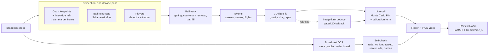

# Architecture

SEKME turns one broadcast video into line calls with an uncertainty, a review log and checks against
what the broadcast itself shows. Everything runs locally (Apple Silicon or CPU).

## Stages and modules

| Stage | Module | What it produces |
|---|---|---|
| Video I/O | `io/video.py` | frames, metadata, writer for HUD videos |
| Court calibration | `perception/court.py`, `models/court_unet.py` (our network, default) or `models/court_net.py`, `calib/line_refine.py`, `calib/camera.py`, `geometry/court.py` | per-frame homography and pinhole camera; frames not backed by the painted lines are marked uncalibrated |
| Shot cuts | `perception/court.py` (`detect_shot_cuts`) | segment boundaries; no flight crosses a cut |
| Ball | `perception/ball.py`, `models/ball_unet.py` (our network, default) or `models/wasb_hrnet.py` | per-frame candidates → one cleaned track (outliers, court marks, short gaps); 60 fps video feeds every second frame |
| Players and pose | `perception/players.py`, `perception/pose.py`, `models/person_unet.py`, `models/pose_unet.py` (our distilled networks) or YOLO26 | near/far player tracks on the court plane (tracks reset at cuts); keypoints at contacts |
| Image-track geometry | `events/image_track.py` | two-piece changepoints, line-meeting kinks (bounces, serve contact) |
| Strokes | `events/hits.py` | persistent reversals of the ball's travel direction |
| Serves | `events/serves.py` | toss above a baseline player after a dead ball, contact at the toss/struck-flight meeting point |
| Flights | `events/flights.py`, `physics/flight.py` | one bounce per flight, 3D fit, plausibility gates, gated 2D fallback |
| Calls | `officiating/line_call.py` | P(in), margin and 1σ across the governing line; IN/OUT only at ≥ 95 % |
| Strokes type | `events/strokes.py` | forehand / backhand / volley / overhead / serve, hand |
| Broadcast check | `broadcast/ocr.py`, `broadcast/scoreboard.py`, `eval/broadcast_check.py` | names, score, serve-speed board; used to check the system, never as an input to a call |
| Analytics | `analytics/kinematics.py` | player speed, distance, peaks |
| Output | `pipeline.py`, `render/hud.py`, `api/app.py`, `web/` | `report.json`, `frames.json`, HUD videos, Review Room with an append-only review log |
| Training and evaluation | `models/unet.py`, `scripts/train_*.py`, `scripts/eval_*.py`, `eval/labels.py`, `eval/tracknet.py`, `eval/sim_benchmark.py` | our networks' training, own-footage labels, TrackNet benchmark, simulation benchmark, network tests |

## Design rules

- **Never more certain than the evidence.** Every bounce carries a covariance from the fit plus a
  calibration term; a call is decisive only at ≥ 95 %. Close calls are shown as the most likely
  verdict marked *low confidence*.
- **Measure, do not assume.** Each change to the event logic is checked on independent data
  (TrackNet games never used for tuning, the stadium radar) and rejected when it does not hold up there;
  rejected experiments are documented in `docs/EVAL_TRACKNET.md`.
- **Caches are keyed by the video hash.** `--reuse-perception` re-runs everything after perception in
  seconds, which is how regressions are checked.
