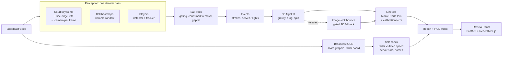

# Architecture

SEKME turns one broadcast video into line calls with an uncertainty, a review log and checks against
what the broadcast itself shows. Everything runs locally (Apple Silicon or CPU).

## Stages and modules

| Stage | Module | What it produces |
|---|---|---|
| Video I/O | `io/video.py` | frames, metadata, writer for HUD videos |
| Court calibration | `perception/court.py`, `models/court_unet.py` (our network, default) or `models/court_net.py`, `calib/line_refine.py`, `calib/camera.py`, `geometry/court.py` | per-frame homography and pinhole camera; frames not backed by the painted lines are marked uncalibrated |
| Shot cuts | `perception/court.py` (`detect_shot_cuts`) | segment boundaries; no flight crosses a cut |
| Ball | `perception/ball.py`, `models/ball_unet.py` (our network, default) or `models/wasb_hrnet.py` | per-frame candidates → one cleaned track (outliers, court marks, short gaps); 60 fps video feeds every second frame |
| Players and pose | `perception/players.py`, `perception/pose.py`, `models/person_unet.py`, `models/pose_unet.py` (our distilled networks) or YOLO26 | near/far player tracks on the court plane (tracks reset at cuts); keypoints at contacts |
| Image-track geometry | `events/image_track.py` | two-piece changepoints, line-meeting kinks (bounces, serve contact) |
| Strokes | `events/hits.py` | persistent reversals of the ball's travel direction |
| Serves | `events/serves.py` | toss above a baseline player after a dead ball, contact at the toss/struck-flight meeting point |
| Flights | `events/flights.py`, `physics/flight.py` | one bounce per flight, 3D fit, plausibility gates, gated 2D fallback |
| Calls | `officiating/line_call.py` | P(in), margin and 1σ across the governing line; IN/OUT only at ≥ 95 % |
| Strokes type | `events/strokes.py` | forehand / backhand / volley / overhead / serve, hand |
| Broadcast check | `broadcast/ocr.py`, `broadcast/scoreboard.py`, `eval/broadcast_check.py` | names, score, serve-speed board; used to check the system, never as an input to a call |
| Analytics | `analytics/kinematics.py` | player speed, distance, peaks |
| Output | `pipeline.py`, `render/hud.py`, `api/app.py`, `web/` | `report.json`, `frames.json`, HUD videos, Review Room with an append-only review log |
| Training and evaluation | `models/unet.py`, `scripts/train_*.py`, `scripts/eval_*.py`, `eval/labels.py`, `eval/tracknet.py`, `eval/spot.py`, `eval/six_videos.py`, `eval/provenance.py`, `eval/sim_benchmark.py` | our networks' training, own-footage labels, TrackNet benchmark, E2E-Spot and six-video test protocols with their run checks, simulation benchmark, network tests |

## Design rules

- **Never more certain than the evidence.** Every bounce carries a covariance from the fit plus a
  calibration term; a call is decisive only at ≥ 95 %. Close calls are shown as the most likely
  verdict marked *low confidence*.
- **Measure, do not assume.** Each change to the event logic is checked on independent data
  (TrackNet games never used for tuning, the stadium radar) and rejected when it does not hold up there;
  rejected experiments are documented in `docs/EVAL_TRACKNET.md`.
- **Caches are keyed by the video hash, the networks and the settings they depend on** (ball stride,
  calibrator keyframe interval, shot-cut threshold, person input size; poses also by each hit's side and box).
  `--reuse-perception` re-runs everything after perception in seconds, which is how regressions are checked.

## Candidates (off by default)

Changes that are written and tested but not yet decided run only with their flag; each has a rule written
before its test data is seen, and becomes the default only by that rule (rejected ones are removed and
documented). `report.json` lists the flags a run used under `candidates`.

| Flag | What it changes | Decided by |
|---|---|---|
| `--fps-scaled-thresholds` | frame counts set on 30 fps video (court-fixed filter, toss-run gap, toss speed per frame) scaled by round(fps / 30) | `docs/EVAL_SERVE_SPEED.md`, second candidate |
| `--player-size-from-camera` | the player size gate from the calibrated camera (band 0.5–1.6 of a standing 1.85 m player) instead of one track's median height | `docs/EVAL_SERVE_SPEED.md`, third candidate |
| `--pin-serve-height` | the flight fit held at the serve contact height measured on the camera ray (±0.05 m) | `docs/EVAL_SERVE_SPEED.md` |
| `--toss-bridge` | a toss run may span a missed apex; the serve contact is searched over the whole run | withdrawn from its test (`docs/EVAL_SPOT.md`); reported only |

## Frame rates

The networks and most thresholds were developed on 30 fps video (TrackNet). The ball network adapts by
its input stride (frames 0, 2, 4 at 60 fps). Thresholds in seconds (`0.12 * fps`, `0.4 * fps`, the dead-ball
second) mean the same at any rate; those counted in frames cover half the time at 60 fps:

| Count (frames) | Where | At 30 fps | At 60 fps | `--fps-scaled-thresholds` |
|---|---|---|---|---|
| court-fixed window ±15, 10 hits | `perception/ball.py` `drop_court_fixed` | ±0.5 s, 0.33 s | ±0.25 s, 0.17 s: removes the toss apex | scaled |
| toss-run gap 2, toss speed per frame | `events/serves.py` | 0.07 s | 0.03 s | scaled |
| tracker gap 6 | `perception/ball.py` `track_ball` | 0.2 s | 0.1 s | not scaled |
| serve contact windows (b − 2 … b + 3, `refine_contact` 3, `contact_in_gap` 2) | `events/serves.py`, `events/image_track.py` | 0.07–0.1 s | 0.03–0.05 s | not scaled |
| skipped contact frames (s + 2, e − 1) | `events/flights.py` | 0.07 s | 0.03 s | not scaled |
| image-kink points (2 each side) | `events/flights.py` `image_bounce` | 0.07 s | 0.03 s | not scaled |

The 60 fps development evidence (US Open 2025 clips and the same footage at 30 fps) is in
`docs/EVAL_SERVE_SPEED.md`; the rows marked "not scaled" are candidates for a later round.

## Known issues (code review, 2026-11-14)

Two code reviews read the event, physics, call, tracker, calibration and OCR modules. The bugs that could
change a ball track or crash were fixed (`docs/EVAL_TRACKNET.md`, "Ball tracker bugs"; the OCR and
calibration guards). Left as they are, because changing them changes how existing broadcast graphics are
read and that can only be checked by re-reading every clip:

- `broadcast/scoreboard.py`: the tolerance for lining up score columns is half a row height in normalised
  x, which is about 0.9 row heights in pixels on 16:9 video; a missing digit in one row could take the
  other row's token.
- `broadcast/scoreboard.py`: a graphic without a point column whose last set reads "0 0" is taken as
  showing points, so that frame's end-change count is one short (it can only mislabel names, never a call).

**Rule for fixing these two (written 2026-11-14, before any comparison).** Fixes: the column tolerance converted
to horizontal units with the frame's aspect ratio (half a row height in pixels); a last column whose values are
all "0" and that holds no point-only value (15, 30, 40, AD) is a games column, not points, unless the graphic's
other readings in the same clip show a point column. Measured on the six broadcast clips with the OCR run once
more and its text boxes kept (so later parsing changes need no OCR): every score reading the fixes change is
checked by eye on its frame. Adopted if the fixed reading is right on more of the changed frames than the old
one and the serve-anchored names of the US Open 2025 final 150–704 s clip stay 21 / 21 correct against the
labeller's serve identities; if no reading changes, adopted as a correctness fix with that result recorded.
Otherwise the code stays and the result is recorded here.

**Result (2026-11-14).** The six clips were read again by OCR (2402 frames, one every 0.5 s) and each frame was
parsed by the old and the corrected column tolerance: **no reading changed** (real graphics space their columns
about 0.023 of the frame width apart, wider than either tolerance), so the tolerance correction is adopted as a
correctness fix and the 2025 final's names are unchanged by construction. The "0 0" case **never occurred** (no
reading with a 0–0 point column in any frame), so the second correction, which needs the clip's other readings
to decide, was not written: nothing here could test it, and it stays a known issue. The text boxes are kept in
`data/broadcast_ocr/` (per frame, with the frame size; re-parsing without the video skips the serving marker),
collected by `devir/scratch/ocr_collect.py`.

Also from the pipeline review (2026-11-14), checked and left:

- The serving hand is voted per player name; without names (no OCR), per side, which pools two players
  across an end change and can mislabel a left-hander's forehand and backhand (strokes only, never a call).
- Poses are read by seeking to each hit frame; on the 60 fps 1080p footage 25 of 25 sampled frames were
  identical to sequential decoding, so this was not changed.

Fixed in the same review: the perception cache key now includes the calibrator's keyframe interval, the
shot-cut threshold and the person detector's input size (older caches are read as made with the defaults,
which have not changed since they were added); the pose cache key includes each hit's side and player box, so
another player selection at the same frames (`--player-size-from-camera`) does not reuse the poses; a labelled
bounce on the other half of the court is scored as outside its zone, not inside it (zones are open at the net).

## Review Room security (security review, 2026-11-14)

The Review Room is a single-user tool for this machine. A security review found no HIGH findings; it is now
hardened against the two ways a web page in the same browser could reach it:

- **DNS rebinding:** only the host names 127.0.0.1, localhost and ::1 (with any port) are answered (400
  otherwise).
- **Cross-site writes:** a write whose `Origin` is not this host and port is refused (403), also on a
  network address. A plain HTML form can post a file without a preflight, so the upload endpoint was
  reachable before. The web dev server proxies with `changeOrigin: false` so its Origin and Host match.
- **One analysis at a time:** uploaded jobs queue behind each other (one GPU job), and an upload is refused
  when less than 1 GB is free.
- **Source video link:** served only if both the link and its target are videos; a re-analysis from
  another video replaces the old link.
- **Logs:** a truncated line in `reviews.jsonl` or `labels.jsonl` is skipped instead of failing the page.

`sekme serve --host 0.0.0.0` still works, with a warning: it has no authentication (any host name is then
answered; writes still have to be same-origin). Not changed:
`--reuse-perception` loads the run folder's `*.pkl` caches with `pickle`, which executes code from a crafted
file, so reuse only run folders you made (or restored from your own private repo).
