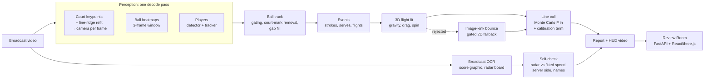

# Architecture

SEKME turns one broadcast video into line calls with an uncertainty, a review log and checks against
what the broadcast itself shows. Everything runs locally (Apple Silicon or CPU).

## Stages and modules

| Stage | Module | What it produces |
|---|---|---|
| Video I/O | `io/video.py` | frames, metadata, writer for HUD videos |
| Court calibration | `perception/court.py`, `models/court_unet.py` (our network, default) or `models/court_net.py`, `calib/line_refine.py`, `calib/camera.py`, `geometry/court.py` | per-frame homography and pinhole camera; frames not backed by the painted lines are marked uncalibrated |
| Shot cuts | `perception/court.py` (`detect_shot_cuts`) | segment boundaries; no flight crosses a cut |
| Ball | `perception/ball.py`, `models/ball_unet.py` (our network, default) or `models/wasb_hrnet.py` | per-frame candidates → one cleaned track (outliers, court marks, short gaps); 60 fps video feeds every second frame |
| Players and pose | `perception/players.py`, `perception/pose.py`, `models/person_unet.py`, `models/pose_unet.py` (our distilled networks) or YOLO26 | near/far player tracks on the court plane (tracks reset at cuts); keypoints at contacts |
| Image-track geometry | `events/image_track.py` | two-piece changepoints, line-meeting kinks (bounces, serve contact) |
| Strokes | `events/hits.py` | persistent reversals of the ball's travel direction |
| Serves | `events/serves.py` | toss above a baseline player after a dead ball, contact at the toss/struck-flight meeting point |
| Flights | `events/flights.py`, `physics/flight.py` | one bounce per flight, 3D fit, plausibility gates, gated 2D fallback |
| Calls | `officiating/line_call.py` | P(in), margin and 1σ across the governing line; IN/OUT only at ≥ 95 % |
| Strokes type | `events/strokes.py` | forehand / backhand / volley / overhead / serve, hand |
| Broadcast check | `broadcast/ocr.py`, `broadcast/scoreboard.py`, `eval/broadcast_check.py` | names, score, serve-speed board; used to check the system, never as an input to a call |
| Analytics | `analytics/kinematics.py` | player speed, distance, peaks |
| Output | `pipeline.py`, `render/hud.py`, `api/app.py`, `web/` | `report.json`, `frames.json`, HUD videos, Review Room with an append-only review log |
| Training and evaluation | `models/unet.py`, `scripts/train_*.py`, `scripts/eval_*.py`, `eval/labels.py`, `eval/tracknet.py`, `eval/spot.py`, `eval/six_videos.py`, `eval/provenance.py`, `eval/sim_benchmark.py` | our networks' training, own-footage labels, TrackNet benchmark, E2E-Spot and six-video test protocols with their run checks, simulation benchmark, network tests |

## Design rules

- **Never more certain than the evidence.** Every bounce carries a covariance from the fit plus a
  calibration term; a call is decisive only at ≥ 95 %. Close calls are shown as the most likely
  verdict marked *low confidence*.
- **Measure, do not assume.** Each change to the event logic is checked on independent data
  (TrackNet games never used for tuning, the stadium radar) and rejected when it does not hold up there;
  rejected experiments are documented in `docs/EVAL_TRACKNET.md`.
- **Caches are keyed by the video hash, the networks and the settings they depend on** (ball stride,
  calibrator keyframe interval, shot-cut threshold, person input size; poses also by each hit's side and box).
  `--reuse-perception` re-runs everything after perception without the networks (seconds on a short clip, a few
minutes on a long one), which is how regressions are checked.

## Candidates (off by default)

Changes that are written and tested but not yet decided run only with their flag; each has a rule written
before its test data is seen, and becomes the default only by that rule (rejected ones are removed and
documented). `report.json` lists the flags a run used under `candidates`.

| Flag | What it changes | Decided by |
|---|---|---|
| `--fps-scaled-thresholds` | frame counts set on 30 fps video (court-fixed filter, toss-run gap, toss speed per frame) scaled by round(fps / 30) | `docs/EVAL_SERVE_SPEED.md`, second candidate |
| `--player-size-from-camera` | the player size gate from the calibrated camera (band 0.5–1.6 of a standing 1.85 m player) instead of one track's median height | `docs/EVAL_SERVE_SPEED.md`, third candidate |
| `--pin-serve-height` | the flight fit held at the serve contact height measured on the camera ray (±0.05 m) | `docs/EVAL_SERVE_SPEED.md` |
| `--toss-bridge` | a toss run may span a missed apex; the serve contact is searched over the whole run | withdrawn from its test (`docs/EVAL_SPOT.md`); reported only |

## Where the time goes (profiled 2026-11-14)

A run from cached detections (`--reuse-perception --no-render`) of the 554 s, 60 fps US Open 2025 final clip
takes 185 s: 164 s analysis, of which the 3D flight fits are about 89 % (`physics/flight.py`: 164 fits,
~38 000 batched RK4 integrations, ~12 million acceleration evaluations on batches of about 12 rows). The cost
is NumPy's per-call overhead on such small arrays, not arithmetic. Fewer RK4 steps would not help at 60 fps
(already one step per frame there; only 30 fps clips take two) and would change results; larger gains need
compiled code, which means a new dependency. Nothing was changed; this is the reference for the six-video
test's cached variant runs (five per video).

**Memory (measured 2026-11-14, 554 s clip, 33 209 frames, cached detections).** Peak 711 MB in the process:
347 MB after importing the libraries, then the detections (+300 MB, mostly the person boxes), calibration
(+25 MB) and the rest of the analysis (+40 MB); the frame file is 4.9 MB of text. About 11 kB per frame, so a
two-hour match at 60 fps (~430 000 frames) would need about 5 GB and a 64 MB frame file: within this machine's
16 GB, but not tested on such a video.

**Perception on 1080p60 (measured 2026-11-14, first 600 frames of the 2025 final clip, MPS).** 67 ms per frame:
the ball network 31.7 ms (one inference per frame on a t, t+2, t+4 window), the person network (YOLO26-s at
1280 px, tracked) 34.5 ms, decoding 0.7 ms, cut detection 0.1 ms; the court calibrator's worker thread never held
the loop up. Both networks are bound by GPU arithmetic: batching 2-8 ball windows per call gives bit-identical
heatmaps but only about 5 % less time per window, and PyTorch's MPS backend runs one stream, so running the two
networks in separate threads would not overlap their GPU work. Faster perception would mean fewer inferences
(e.g. every second window at 60 fps) or smaller inputs, which change the detections and would need their own
rule and test; nothing was changed. (These 600 frames cost less per frame than the README's full-run figures for
a 90 s 1080p60 clip, 190 s and 483 s; the cost depends on the scene and on the machine's load.)

**The fits in worker processes (2026-11-14).** The flights of a run are planned in order and then fitted
independently of each other, so `build_flights` can hand the fits to a process pool (`--fit-workers N` or
`SEKME_FIT_WORKERS`; workers get the track, calibration and players once). On the same clip, cached detections,
no rendering or OCR: analysis 143.2 s in turn (the 164 s above was measured earlier, under other load), 45.4 s
with 4 workers, and the report is identical apart from its
creation time and timings (also checked in a test, flight by flight, to the bit). The library fits in turn by
default: the workers import the code afresh, so a script that patches it at run time (as the development
experiments in `devir/scratch` do, calling `pipeline.analyze` in-process) must stay at one process. `sekme analyze`
and `sekme serve` are never patched, so they default to half the cores, at most 4 (`--fit-workers 1` or
`SEKME_FIT_WORKERS=1` fits in turn); the evaluation scripts run the command line in a subprocess and get the same
results faster. Short runs (fewer than 24 fits) are fitted in turn anyway.

**Review Room on a long run (measured 2026-11-14, 554 s clip, 33 209 frames, 237 shots).** Playback and frame
steps: the timeline used to rebuild its ~600 markers on every frame (54.7 ms median per step, development
build); it now builds them once per run, selection and zoom (3.9 ms). Opening the run takes about 2 s (warm):
the 4.8 MB frame file parses in 11 ms; the panels' React rendering is ~2.2 s in the development build (a few
times less in production); a layout pass over ~4 500 elements (~0.4 s) and a forced reflow (~0.4 s) account for
much of the rest. (Both were taken up later the same day, below: the forced reflow came from the frame overlay,
and off-screen shot rows are no longer rendered.)

**Switching runs, attributed (2026-11-14, production and profiling builds, same clip).** On this machine under
other load, identical switches to the 554 s run took 1–6 s until the shot list was painted, so wall-clock times
are not comparable between builds; the work was attributed with the browser's CPU profile instead. While the
next report loads, the page shows a spinner, so every panel is unmounted and mounted again. The largest single
part was the 3D replay: each mount created a new WebGL context, compiled its shaders, rebuilt the court and
uploaded its texture (about 0.9 s for context and court, then about 1.4 s of first renders with the texture
upload in one profile; GPU-bound calls stall longer while the new video starts decoding). **Changed:** the
renderer, scene and camera are made once per page and the panel only attaches and detaches the canvas
(`Replay3D.tsx`, `getEngine`); a lost WebGL context is detected on the next mount and replaced, a context
restored while mounted gets the theme colour again, and the pixel ratio is read on every mount. Its render loop
now runs only while something changes (camera easing after a drag, a preset move, playback, a redraw request):
idle, the page requests no animation frames (it used to request one every frame for the life of the page).
Checked: WebGL
contexts created over a page load and three run switches 3 → 1; after the switch no context creation, shader
compilation, court build or texture upload appears in the profile; replay, presets and playback work after a
switch and after a forced context loss. The forced reflow on opening came from the frame overlay reading its
canvas's on-screen height while drawing; that height now comes from the canvas's ResizeObserver
(`VideoStage.tsx`), and the profile of a switch shows no layout forced by script (before: about 30 ms in one
profile, more under load). The rest of a switch is React unmounting and mounting about 4 500
elements, the frame overlay and layout. Counted on the 554 s run: of the page's 3 202 elements the shot list
holds 2 233 (237 rows of 10) and the timeline 749; everything else is about 220. Keeping the panels mounted
while the next run loads would therefore save little, and was not done. Instead the shot rows use
`content-visibility: auto` (rows outside the list's view are not styled, laid out or painted; they stay in the
accessibility tree): in the browser's trace of the same switch, the largest layout went from 4 467 to 1 195
objects, all layouts from 4 680 to 1 936 and styled elements from 3 205 to 1 551 (counts, which do not depend on
the machine's load as times do); Lighthouse stays at 100, and keyboard selection to the last row and back
scrolls and draws the row (checked with End, ArrowUp and Home).

**Review ↔ analysis page.** The analysis page used to be built from scratch on every switch (all its charts and
tables over the run's shots, then a layout of the new page) and torn down on the way back. It is now built the
first time it is opened for a run and then only hidden by a wrapper (`App.tsx`, `analysis-host`), so later
switches change two `hidden` attributes and re-render nothing of it (checked: after the first open a switch
adds or removes at most three nodes); player names are formatted once (`displayName` caches them; the page
asked for the same few names thousands of times on the 554 s run), and the video overlay is not redrawn while
the review page is hidden.

## Frame rates

The networks and most thresholds were developed on 30 fps video (TrackNet). The ball network adapts by
its input stride (frames 0, 2, 4 at 60 fps). Thresholds in seconds (`0.12 * fps`, `0.4 * fps`, the dead-ball
second) mean the same at any rate; those counted in frames cover half the time at 60 fps:

| Count (frames) | Where | At 30 fps | At 60 fps | `--fps-scaled-thresholds` |
|---|---|---|---|---|
| court-fixed window ±15, 10 hits | `perception/ball.py` `drop_court_fixed` | ±0.5 s, 0.33 s | ±0.25 s, 0.17 s: removes the toss apex | scaled |
| toss-run gap 2, toss speed per frame | `events/serves.py` | 0.07 s | 0.03 s | scaled |
| tracker gap 6 | `perception/ball.py` `track_ball` | 0.2 s | 0.1 s | not scaled |
| serve contact windows (b − 2 … b + 3, `refine_contact` 3, `contact_in_gap` 2) | `events/serves.py`, `events/image_track.py` | 0.07–0.1 s | 0.03–0.05 s | not scaled |
| skipped contact frames (s + 2, e − 1) | `events/flights.py` | 0.07 s | 0.03 s | not scaled |
| image-kink points (2 each side) | `events/flights.py` `image_bounce` | 0.07 s | 0.03 s | not scaled |

The 60 fps development evidence (US Open 2025 clips and the same footage at 30 fps) is in
`docs/EVAL_SERVE_SPEED.md`; the rows marked "not scaled" are candidates for a later round.

## Known issues (code review, 2026-11-14)

Two code reviews read the event, physics, call, tracker, calibration and OCR modules. The bugs that could
change a ball track or crash were fixed (`docs/EVAL_TRACKNET.md`, "Ball tracker bugs"; the OCR and
calibration guards). These two were left at first, because changing them changes how existing broadcast
graphics are read and that can only be checked by re-reading every clip (the first was then corrected, the
second remains open; see the result below):

- `broadcast/scoreboard.py`: the tolerance for lining up score columns is half a row height in normalised
  x, which is about 0.9 row heights in pixels on 16:9 video; a missing digit in one row could take the
  other row's token.
- `broadcast/scoreboard.py`: a graphic without a point column whose last set reads "0 0" is taken as
  showing points, so that frame's end-change count is one short (it can only mislabel names, never a call).

**Rule for fixing these two (written 2026-11-14, before any comparison).** Fixes: the column tolerance converted
to horizontal units with the frame's aspect ratio (half a row height in pixels); a last column whose values are
all "0" and that holds no point-only value (15, 30, 40, AD) is a games column, not points, unless the graphic's
other readings in the same clip show a point column. Measured on the six broadcast clips with the OCR run once
more and its text boxes kept (so later parsing changes need no OCR): every score reading the fixes change is
checked by eye on its frame. Adopted if the fixed reading is right on more of the changed frames than the old
one and the serve-anchored names of the US Open 2025 final 150–704 s clip stay 21 / 21 correct against the
labeller's serve identities; if no reading changes, adopted as a correctness fix with that result recorded.
Otherwise the code stays and the result is recorded here.

**Result (2026-11-14).** The six clips were read again by OCR (2402 frames, one every 0.5 s) and each frame was
parsed by the old and the corrected column tolerance: **no reading changed** (real graphics space their columns
about 0.023 of the frame width apart, wider than either tolerance), so the tolerance correction is adopted as a
correctness fix and the 2025 final's names are unchanged by construction. The "0 0" case **never occurred** (no
reading with a 0–0 point column in any frame), so the second correction, which needs the clip's other readings
to decide, was not written: nothing here could test it, and it stays a known issue. The text boxes are kept in
`data/broadcast_ocr/` (per frame, with the frame size; re-parsing without the video skips the serving marker),
collected by `devir/scratch/ocr_collect.py`.

Also from the pipeline review (2026-11-14), checked and left:

- The serving hand is voted per player name; without names (no OCR), per side, which pools two players
  across an end change and can mislabel a left-hander's forehand and backhand (strokes only, never a call).
- Poses are read by seeking to each hit frame; on the 60 fps 1080p footage 25 of 25 sampled frames were
  identical to sequential decoding, so this was not changed.

Fixed in the same review: the perception cache key now includes the calibrator's keyframe interval, the
shot-cut threshold and the person detector's input size (older caches are read as made with the defaults,
which have not changed since they were added); the pose cache key includes each hit's side and player box, so
another player selection at the same frames (`--player-size-from-camera`) does not reuse the poses; a labelled
bounce on the other half of the court is scored as outside its zone, not inside it (zones are open at the net).

## Radar board pairing: wide update windows without a cut (rule written 2026-11-14, before measuring)

A board value is tied to a serve only when the change is seen within 4 s (`MAX_UPDATE_WINDOW_S`), so that a
value following an edited-out serve is not given to the next one. On the US Open 2025 final 150–704 s clip, whose
19 matched serves have the board read by eye, only a minority get an automatic value (measured below: 1 on the
default run, 9 on the scaled 60 fps run); most of the rest are dropped for that window although the board shows the right number (the board is not on screen
all the time). **Change:** a wider window is accepted when the serve's whole search window lies inside one span
the pipeline could analyse (no shot cut, calibrated) and exactly one serve is a candidate, since then no
edited-out serve can be behind the value. **Rule:** adopted if, on that clip (development data; the scaled
60 fps run, which finds 20 of its 23 serves, and the default run), the automatic values that agree with the eye
reading (within 1 mph) rise by at least 3 in total and no automatic value disagrees that agreed before; the
five radar clips' table (`results/radar.txt`) is reported, not used. Otherwise the code stays and the result
is recorded here.

**Result (2026-11-14): not adopted.** Automatic values on the eye-read serves: default run 1 agreeing before
and after; scaled run 8 agreeing and 1 disagreeing before and after (+0, the rule asked for +3); the pairs
with a window of at most 4 s were identical to the earlier report. In highlight footage a widened window plus the
6.5 s serve lag spans more than 10 s, which almost never lies inside one cut-free span, so the dropped updates
stay dropped. The code was left as it was. The one disagreeing value (serve at frame 186: board read 101 mph by
eye, paired 125) is the stale-value case noted above.

## Review Room security (security review, 2026-11-14)

The Review Room is a single-user tool for this machine. A security review found no HIGH findings; it is now
hardened against the two ways a web page in the same browser could reach it:

- **DNS rebinding:** only the host names 127.0.0.1, localhost and ::1 (with any port) are answered (400
  otherwise).
- **Cross-site writes:** a write whose `Origin` is not this host and port is refused (403), also on a
  network address. A plain HTML form can post a file without a preflight, so the upload endpoint was
  reachable before. The web dev server proxies with `changeOrigin: false` so its Origin and Host match.
- **One analysis at a time:** uploaded jobs queue behind each other (one GPU job), and an upload is refused
  when less than 1 GB is free.
- **Source video link:** served only if both the link and its target are videos; a re-analysis from
  another video replaces the old link.
- **Logs:** a truncated line in `reviews.jsonl` or `labels.jsonl` is skipped instead of failing the page.

`sekme serve --host 0.0.0.0` still works, with a warning: it has no authentication (any host name is then
answered; writes still have to be same-origin). Not changed:
`--reuse-perception` loads the run folder's `*.pkl` caches with `pickle`, which executes code from a crafted
file, so reuse only run folders you made (or restored from your own private repo).

## Inputs that are not a tennis video (checked 2026-11-14)

Eight files made locally were analysed (`sekme analyze`, default options). A 0-byte file, a text file, a
truncated MP4 and an audio-only MP4 used to end in a Python traceback (the ffprobe command with the server's
path, or an empty `StopIteration`), left an empty run folder, and in the Review Room kept the upload; an audio
file with cover art passed as a 90 000 fps "video" (its picture stream). Now `probe` raises
`UnreadableVideoError` (`courtvision/errors.py`) with one line naming the file, never its folder ("video
okunamadı (…)" with ffprobe's last message, folder and decoder addresses removed; "dosyada video akışı yok",
cover art not counted; "video akışının boyutu yok"; "video akışında kare hızı yok"; "video bilgileri
okunamadı" for malformed metadata); `analyze` probes before creating the run folder; the command line prints
`hata: …` and exits with 2; an upload job shows the message with the name the user picked (last path segment,
no control characters, at most 80 characters) and deletes the upload. The ten broadcast clips and three valid
synthetic clips probe exactly as before. A one-frame clip, two seconds of black and a portrait test pattern
run to the end: no frame calibrated, no flight, no call.

**Phone videos stored sideways (found and fixed 2026-11-14).** A phone often stores a landscape recording
sideways with a rotation tag. OpenCV and ffmpeg decode such frames upright, but `probe` reported the stored size,
which scales every ball position: a 4 s broadcast excerpt re-encoded that way (pixels transposed, tag rotating
them back) gave one REVIEW call instead of the original's three IN calls, with its ball points shrunk by
720/1280, and its rendered videos were written at the stored 720 × 1280 size from 1280 × 720 frames. `probe` now swaps width and height for a 90° or 270° rotation (display matrix, or the older `rotate`
tag); the same excerpt then gives the original's calls (margins +1.46, +2.78, +1.09 m against +1.46, +2.78,
+1.10 m, the last from the re-encoding's colour sampling) and its ball points (median 0 px, at most 0.41 px). The
ten broadcast clips have no rotation and probe exactly as before. Every OpenCV capture now asks for upright
frames explicitly (`open_video`; the default depends on the build), and perception stops with a clear message
if the first decoded frame does not have the probed size.

**Variable frame rate (2026-11-14).** The pipeline takes a frame's time as its index divided by the frame rate.
Phones can drop or stretch frames (variable frame rate); then speeds around those frames and the marks drawn on
the video drift. The ten broadcast clips are perfectly even (every interval within 0.1 % of the median, from
the packet timestamps); a re-encoded excerpt with three dropped frames shows three intervals of twice the median.
Each report now counts the intervals more than 25 % off the median (`video.irregular_frame_intervals`, read with
ffprobe in well under a second) and, when there are any, adds a limitation in Turkish that the Review Room shows
and the command line repeats as a warning. Using the real timestamps throughout would be the fix; it touches
every time computation and is not done.

**Codecs.** One-second excerpts re-encoded as HEVC (MP4), VP9 (WebM and MP4) and AV1 (MP4) probe and decode
with the size and frame count `probe` reports, and play in the Review Room. The source video used to be served
as `video/mp4` whatever its container (Chrome played a WebM anyway by sniffing it); it is now served with its
container's type (`video/webm`, `video/quicktime`, `video/x-matroska`).

**120 fps.** A 2 s excerpt of the 2023 final interpolated to 120 fps (ffmpeg `minterpolate`, blended frames, so
not real slow motion) runs to the end: all 240 frames calibrated, ball network stride 4, and its first call is
the 30 fps excerpt's (IN, +147 cm against +146 cm). Real high-frame-rate footage has not been tested; the
frame-count thresholds discussed above apply four times more strongly there.

**Other shapes and sizes.** The same 4 s excerpt (1280 × 720, three IN calls at +1.46, +2.78, +1.09 m, 1σ 2, 14,
9 cm): centre-cropped to 4:3 (960 × 720), every frame still calibrates (line RMSE 0.31 px) and the calls are
+1.45, +2.78, +1.10 m; scaled down to 640 × 360, the calls are +1.46, +2.74, +1.08 m with 1σ 4, 28, 16 cm, about
twice as wide as the pixels are twice as large.

Compressed harder (x264, same excerpt; calls as bounce frame, margin, 1σ):

| CRF | ball found | calls |
|---|---|---|
| original | 115 / 119 | 27: +1.46 m ±2 cm · 65: +2.78 ±14 · 104: +1.09 ±9 |
| 32 | 107 | +1.46 ±2 · +2.75 ±14 · +1.08 ±9 |
| 35 | 90 | +1.45 ±2 · +2.75 ±14 · +1.08 ±9 |
| 37 | 61 | +1.46 ±3 · (no call) · +1.05 ±8 |
| 38 | 44 | +1.46 ±4 · +2.67 ±17 · +1.05 ±9 |
| 40 | 19 | none (was one spurious call, below) |

Calls fade to "no call" rather than turning wrong, except for one case at CRF 40: the flights merged and the
image-kink fallback gave a confident call at a point 4.7 m from the real bounce. That fallback now needs its
detections within 0.25 s (`docs/EVAL_TRACKNET.md`, rule written first; no call changed on TrackNet or the
broadcast runs), so that copy gets no call and the flight says why.

**Low frame rates.** The same excerpt reduced to 15 fps keeps its first two calls (+1.45 and +2.78 m) but places
the third bounce 2.5 m short in depth (the ball travels about 2.5 m between two frames there); the reported depth
1σ widens from 9 to 73 cm, not enough to cover it. The lateral position stays right (x 1.83 m), and the call,
now against the sideline, is still correct, but a ball landing just over the baseline could be called IN. Videos
below 24 fps now get a limitation in their report and a warning on the command line; calls are not changed (no
measured video is below 24 fps).

**A fresh clone.** The weights are not in the repository. A missing checkpoint used to end in a traceback from
hashing it, after an empty run folder had been made; `analyze` now checks the four checkpoints first and stops with
one line naming the missing ones (`MissingModelError`; the command line exits with 2, a Review Room job shows the
line and keeps the upload). Without a built web app, `sekme serve` answers `/` with a page that says how to build
it instead of a JSON 404. Runs with no calibrated frame and no flight (black, portrait test pattern, one frame) open
in the Review Room with its empty states ("Vuruş bulunamadı", empty analysis cards) and no console error. A run
folder linked into the runs folder from elsewhere is no longer listed: the server never opened it (it only opens
folders that are really inside the runs folder) and used to list it anyway.
